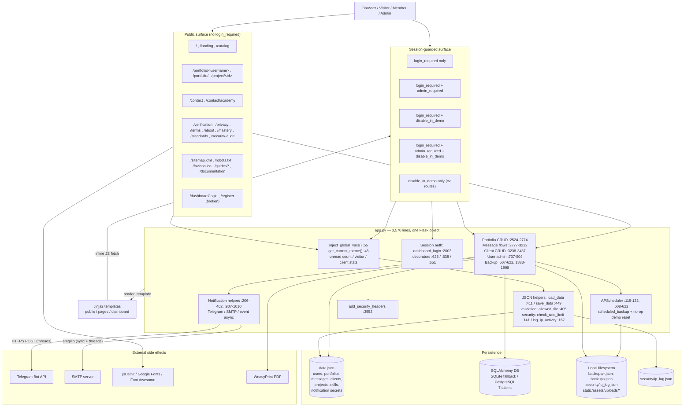
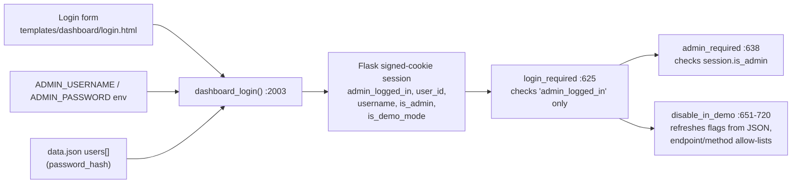
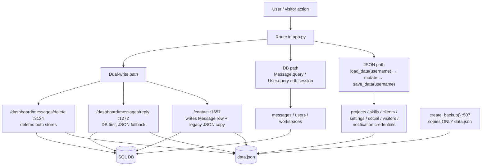

# 02 — Architecture Map (Actual Implementation)

**Evidence base:** static AST scan of `app.py` (72 `@app.route` registrations, 5 error handlers, 1 context processor, 1 `after_request` handler), `models.py`, `config.py`, template tree, static assets, and runtime-created directories.

---

## 1. High-level architecture

The application is a **single-module Flask monolith with dual persistence**. There are no Blueprints, no service layer, no application factory, and no ORM relationships. Business logic, routing, validation, notification delivery, backup/restore, and security middleware all live in `app.py`.

---

## 2. Module inventory

| Module | Size | Role | Status |
| --- | --- | --- | --- |
| `app.py` | 131,660 bytes / 3,570 lines | Routes, auth, business logic, notifications, backups, middleware | Monolith; contains unreachable code |
| `models.py` | 4,456 bytes / 91 lines | 7 SQLAlchemy models + `SafeJSON` TypeDecorator | Used only for `db`, `User`, `Workspace`, `Message` in practice |
| `config.py` | 2,403 bytes / 80 lines | Env-driven config classes + `get_config()` | Duplicated by hard-coded overrides in `app.py:88-96` |
| `data.json` | 11,301 bytes | De facto primary data store | Legacy but authoritative for most features |
| `templates/` | 42 HTML files | 3 hierarchies: root public, `pages/`, `dashboard/` | 5 templates unreferenced by any route |
| `static/` | CSS (7), JS (1), themes (6), images, favicons | Frontend assets | One JS file; no modular frontend build |
| `security/ip_log.json` | 34,507 bytes / 127 entries | IP/event audit log | Written on contact/login events |
| `backups/` | Created at import; absent in snapshot | JSON backup files + metadata | Local-FS only |

---

## 3. Route inventory (AST-derived, exact line numbers)

Legend: **L** = `login_required`, **A** = `admin_required`, **D** = `disable_in_demo`, **P** = public.

### 3.1 Public routes

| Line | Endpoint | Rule | Prot. |
| --- | --- | --- | --- |
| 474 | `user_portfolio` | `/portfolio/<username>` | P |
| 725 | `register` | `/register` | P |
| 1118 | `get_latest_notifications` | `/dashboard/notifications/latest` | P |
| 1368 | `contact_academy` | `/contact/academy` | P |
| 1462 | `index` | `/` | P |
| 1495 | `landing` | `/landing` | P |
| 1501 | `verification` | `/verification` | P |
| 1507 | `privacy` | `/privacy` | P |
| 1513 | `terms` | `/terms` | P |
| 1519 | `about` | `/about` | P |
| 1525 | `mastery` | `/mastery` | P |
| 1531 | `standards` | `/standards` | P |
| 1537 | `security_audit` | `/security-audit` | P |
| 1543 | `catalog` | `/catalog` | P |
| 1657 | `contact` | `/contact` | P |
| 1784 | `project_detail` | `/portfolio/<username>/project/<int:project_id>` | P |
| 1804 | `sitemap` | `/sitemap.xml` | P |
| 1851 | `robots` | `/robots.txt` | P |
| 1875 | `favicon` | `/favicon.ico` | P |
| 2003 | `dashboard_login` | `/dashboard/login` | P |
| 2215 | `guide_bot_token` | `/guides/telegram-bot-token` | P |
| 2221 | `guide_chat_id` | `/guides/telegram-chat-id` | P |
| 2227 | `documentation` | `/documentation` | P |

### 3.2 Authenticated routes

| Line | Endpoint | Rule | Prot. |
| --- | --- | --- | --- |
| 737 | `dashboard_users` | `/dashboard/users` | L A D |
| 748 | `dashboard_view_user` | `/dashboard/user/<int:user_id>` | L A D |
| 779 | `access_instructions` | `/dashboard/access-instructions` | L |
| 788 | `dashboard_toggle_user_verification` | `/dashboard/users/toggle-verification/<user_id>` | L A D |
| 853 | `toggle_user_demo` | `/dashboard/user/<int:user_id>/toggle-demo` | L A D |
| 881 | `delete_user` | `/dashboard/user/<int:user_id>/delete` | L A D |
| 1250 | `dashboard_chat` | `/dashboard/chat`, `/dashboard/chat/<user_id>` | L D |
| 1272 | `dashboard_reply_message` | `/dashboard/messages/reply/<message_id>` | L D |
| 1883 | `view_backups` | `/dashboard/backups` | L |
| 1890 | `create_manual_backup` | `/backup/create` | L |
| 1913 | `restore_backup` | `/backup/restore/<filename>` | L D |
| 1942 | `download_backup` | `/backup/download/<filename>` | L |
| 1964 | `delete_backup` | `/backup/delete/<filename>` | L D |
| 1991 | `api_backups` | `/api/backups` | L |
| 2059 | `dashboard_add_user` | `/dashboard/users/add` | L A D |
| 2161 | `dashboard_logout` | `/dashboard/logout` | L |
| 2170 | `dashboard` | `/dashboard` | L |
| 2241 | `dashboard_settings` | `/dashboard/settings` | L D |
| 2334 | `dashboard_telegram` | `/dashboard/telegram` | L D |
| 2403 | `dashboard_smtp` | `/dashboard/smtp` | L D |
| 2442 | `email_test_connection` | `/dashboard/email-test` | L D |
| 2487 | `telegram_test_connection` | `/dashboard/telegram-test` | L D |
| 2524 | `dashboard_general` | `/dashboard/general` | L D |
| 2552 | `dashboard_about` | `/dashboard/about` | L D |
| 2569 | `dashboard_skills` | `/dashboard/skills` | L D |
| 2605 | `dashboard_projects` | `/dashboard/projects` | L D |
| 2615 | `dashboard_add_project` | `/dashboard/projects/add` | L D |
| 2667 | `dashboard_edit_project` | `/dashboard/projects/edit/<int:project_id>` | L D |
| 2714 | `dashboard_delete_project` | `/dashboard/projects/delete/<int:project_id>` | L D |
| 2729 | `dashboard_contact` | `/dashboard/contact` | L D |
| 2752 | `dashboard_social` | `/dashboard/social` | L D |
| 2780 | `dashboard_messages` | `/dashboard/messages` | L D |
| 2862 | `dashboard_internal_messages` | `/dashboard/messages/internal` | L D |
| 2913 | `dashboard_internal_compose` | `/dashboard/messages/internal/compose[/<receiver_id>]` | L D |
| 2925 | `dashboard_internal_send` | `/dashboard/messages/internal/send` | L D |
| 2998 | `dashboard_internal_view` | `/dashboard/messages/internal/view/<message_id>` | L D |
| 3041 | `dashboard_view_message` | `/dashboard/messages/view/<message_id>` | L D |
| 3124 | `dashboard_delete_message` | `/dashboard/messages/delete/<message_id>` | L D |
| 3169 | `dashboard_convert_message_to_client` | `/dashboard/messages/convert/<message_id>` | L D |
| 3238 | `dashboard_clients` | `/dashboard/clients` | L D |
| 3259 | `dashboard_add_client` | `/dashboard/clients/add` | L D |
| 3355 | `dashboard_edit_client` | `/dashboard/clients/edit/<int:client_id>` | L D |
| 3411 | `dashboard_view_client` | `/dashboard/clients/view/<int:client_id>` | L |
| 3428 | `dashboard_delete_client` | `/dashboard/clients/delete/<int:client_id>` | L D |
| 3443 | `dashboard_change_password` | `/dashboard/change-password` | L D |
| 3510 | `cv_preview` | `/cv-preview` | D |
| 3519 | `download_cv` | `/download-cv` | D |

Global hooks: `inject_global_vars()` (`app.py:55-85`), five error handlers (`app.py:1428-1457`), `add_security_headers()` (`app.py:3551-3565`).

---

## 4. Authentication and authorization model

**Verified properties**

- Login authenticates only against env admin and JSON users (`app.py:2010-2047`). `User` DB rows are never queried during login.
- `DEMO_USER_CREDENTIALS` is defined at `app.py:197-202` but **never used** by any route.
- `login_required` checks only session presence; it does not verify the user still exists or is active (`app.py:625-635`). `User.is_active` (`models.py:38`) is never consulted.
- `disable_in_demo` re-reads `data.json` on each decorated request and resets `is_admin`/`is_demo_mode` from the JSON user record (`app.py:656-668`).
- Role semantics are split: `is_admin` comes from JSON role at login; DB `User.role` is written on user creation (`app.py:2141`) but not consulted for authorization.
- Workspace ownership: JSON data is keyed by `username`, and most dashboard routes simply use `session['username']` (e.g. `app.py:2571`, `2607`, `2740`). DB rows carry `workspace_id`, but authorization queries do **not** filter by workspace (e.g. `app.py:2796-2814`, `2872`).

---

## 5. Data architecture: dual persistence

**Architectural consequence:** the same concept ("message", "user", "project") has two representations with different IDs, read-state fields, and lifecycle rules. No synchronization layer exists; each route re-implements reconciliation ad hoc. See `04_DATABASE_AND_DATA_LIFECYCLE.md`.

---

## 6. Template and frontend architecture

- **Public hierarchy:** `templates/index.html` (portfolio), `landing.html`, `catalog.html`, `project_detail.html`, `public_base.html` (unreferenced).
- **Pages:** 9 informational templates under `templates/pages/`.
- **Dashboard hierarchy:** `templates/dashboard/base.html` is the inherited shell; 24 dashboard content templates.
- **Error pages:** `400.html` (unreferenced), `403/404/500/503.html` (referenced by handlers).
- **Frontend JS:** one global file `static/js/script.js` plus inline `<script>` blocks in `base.html` (notification polling), `settings.html` (tests/backups), `user_profile.html` (delete navigation), `index.html` (contact form), and others.

### 6.1 Verified template/route mismatches

| Finding | Evidence | Status |
| --- | --- | --- |
| `url_for('dashboard_clear_chat')` has no endpoint | `templates/dashboard/chat.html:38`; no such route in `app.py` | VERIFIED — template would raise `BuildError` if rendered (it is currently unreachable) |
| `url_for('payment', plan=...)` has no endpoint | `templates/dashboard/subscription.html:408,425` | VERIFIED — template is unreferenced by any route |
| `url_for('login')` has no endpoint | `app.py:730` in `register()` | VERIFIED — `/register` always raises `BuildError` → 500 |
| `dashboard_mark_read` and `export_data` appear in demo allow/block lists but have no routes | `app.py:684,698` | VERIFIED |
| `internal_view.html` uses `message.date`, but `Message` has only `created_at` | `templates/dashboard/internal_view.html:36`; `models.py:84` | VERIFIED — date renders blank |
| `static/js/script.js:25` dereferences `#themeToggle` without a null check | element exists only in `index.html:67` | VERIFIED — on other pages the DOMContentLoaded handler aborts early |
| `sitemap()` emits `/project/<id>` URLs; no such route exists | `app.py:1817-1828` vs `app.py:1783` | VERIFIED |
| `/documentation` always 404s: expected file absent | `app.py:2229-2235` | VERIFIED |

---

## 7. Background jobs and external integrations map

| Component | Implementation | Trigger | Failure handling |
| --- | --- | --- | --- |
| Backup scheduler | `BackgroundScheduler` created and started at import (`app.py:119-122`); job `scheduled_backup` cron hourly (`app.py:608-614`) | Process start + every hour | try/except + log only (`app.py:593-600`) |
| Demo reset job | Hourly cron calling `reset_demo_data()` (`app.py:616-622`) | Process start + every hour | Function is `pass` (`app.py:603-605`) |
| Telegram admin | `send_admin_notification()` (`app.py:221-238`) | Platform inquiry, verification/access/password events | Thread + bare `except: pass` inside sender |
| Telegram user | `send_user_notification()` (`app.py:264-280`), `send_telegram_notification()` (`app.py:907-948`) | Portfolio messages, new lead, client status change | Log and return `False` |
| Telegram events | `send_telegram_event_notification()` + async wrappers (`app.py:951-1009`) | Login, backup created/restored | Log and return `False`; no retry |
| SMTP | `send_email()` (`app.py:371-402`) + duplicated raw `smtplib` blocks (`app.py:252-260`, `1630-1648`) | Contact, confirmation, tests | Log/return `False`; no retry |
| Notification polling | Inline JS in `base.html:233-309` fetch every 30 s | Every dashboard page load | Console error only |

---

## 8. Monolith, duplication, and legacy structure

**Monolithic components**
- `app.py` holds 72 routes and all supporting logic; no separation between HTTP, domain, persistence, and delivery.
- `inject_global_vars()` performs data loading for every rendered template, including public pages (`app.py:63-65`).

**Duplicated logic**
- Three Telegram senders with different formatting/config sources (`app.py:221`, `264`, `907`, `951`).
- Three SMTP paths (`app.py:371`, `252`, `1630`).
- Database URL normalization in both `config.py:26-27` and `app.py:28-32`.
- Session config in both `config.py:8-12` and `app.py:88-96`.
- Message/list filtering logic repeated in `dashboard_messages`, `dashboard_internal_messages`, `get_unread_messages_count`, and `get_latest_notifications`.
- Unreachable duplicate blocks at `app.py:1360-1364` and `app.py:3106-3118`.

**Legacy implementations still active**
- `data.json` as primary store despite `models.py` existing.
- JSON fallback in message routes (`app.py:1315-1349`, `2831-2847`, `3072-3105`, `3142-3153`).
- Deprecated `/dashboard/chat` routes that immediately redirect (`app.py:1265-1266`).

**Unused modules / symbols**
- `DEMO_USER_CREDENTIALS`, `TELEGRAM_ENABLED`, `load_telegram_config()`, `save_smtp_config()`, `mark_message_as_read()`, `save_message()`, `send_confirmation_email()`.
- Models `Project`, `Skill`, `Client`, `VisitorLog` are imported (`app.py:21`) but never queried or persisted.
- Templates `public_base.html`, `dashboard/chat.html`, `dashboard/subscription.html`, `dashboard/user_profile.html`, `400.html` are never rendered.
- Unused dependencies listed in `01_SYSTEM_BASELINE.md §4.1`.

**Circular dependencies:** none detected. `app.py → models.py`, `app.py → config.py`; a redundant local `from config import get_config` exists inside `index()` (`app.py:1481-1483`) but creates no cycle.

---

## 9. Architecture-level inconsistencies (documented vs actual)

| Documentation claim | Actual code | Status |
| --- | --- | --- |
| "Blueprint/multi-tenant Flask app" (`replit.md:16,22`) | No Blueprints; workspace ID mostly unused in queries | VERIFIED mismatch |
| "Admin/Demo/User role system" (`replit.md:34-37`) | Only boolean `is_admin` and `is_demo_mode`; no permission table; three roles not modeled | VERIFIED mismatch |
| "CSRF protection" (`replit.md:51`) | No CSRF token library or hidden token anywhere | VERIFIED mismatch |
| "Security headers CSP/HSTS/X-Frame-Options" (`replit.md:46`) | CSP is wildcard, HSTS present, X-Frame-Options absent | VERIFIED mismatch |
| "PostgreSQL primary" (`README.md:13`) | Runtime falls back to SQLite; no DB present in snapshot | VERIFIED mismatch in this environment |
| "Backup system" (`replit.md:43`) | Copies `data.json` only; no DB export | VERIFIED mismatch |

---

**Next document:** `03_FEATURE_LIFECYCLE.md` — end-to-end feature traces, with internal communication treated as the priority subsystem.
