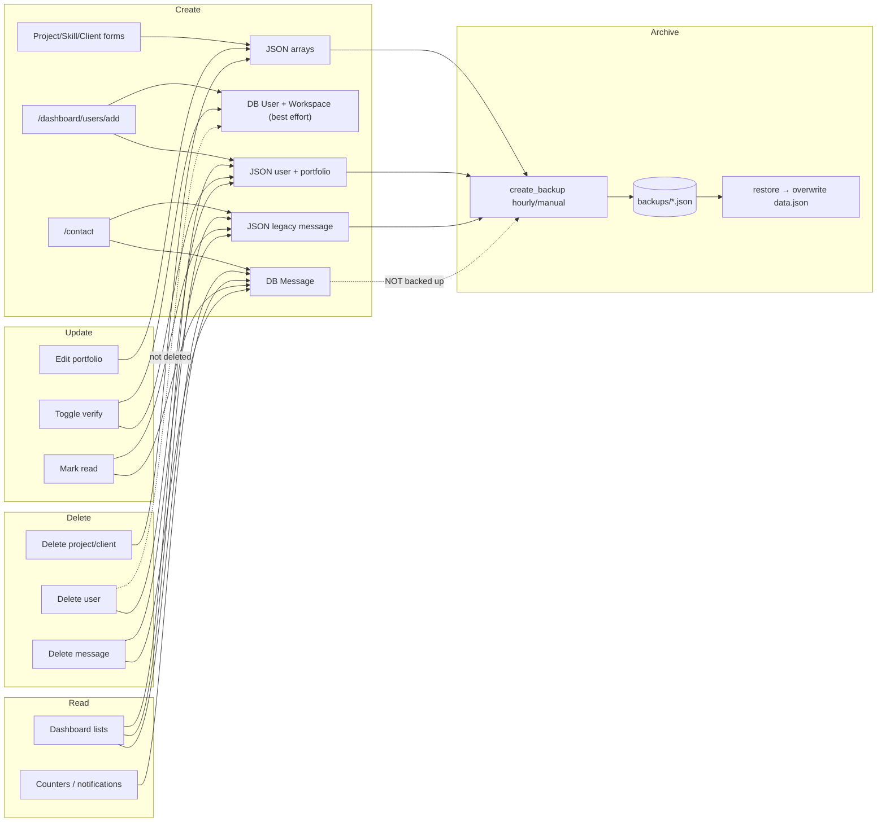

# 04 — Database and Data Lifecycle

---

## 1. Persistence topology

The system has **two independent persistence layers**, plus filesystem state:

| Store | Role | Mechanisms | Authoritative for |
| --- | --- | --- | --- |
| `data.json` | Legacy JSON document store; actually the primary store for most features | `load_data()` `app.py:411-446`, `save_data()` `:449-470` | users, portfolios, projects, skills, clients, general/about/contact/social settings, visitors, legacy messages, notification credentials |
| Relational DB | SQLAlchemy models | `db.create_all()` `app.py:36-41`; queries in `app.py` | `messages` (new contact + internal threads), partial `users`/`workspaces` mirror |
| Local filesystem | Files and logs | direct `open`/`shutil`/`send_file` | backups, backup metadata, IP activity log, uploaded images |

No transaction spans JSON and DB. A failure after one write leaves the stores divergent.

---

## 2. Schema as declared (`models.py`)

### 2.1 Tables and columns

| Table | Column | Type | Constraints / defaults | Line |
| --- | --- | --- | --- | --- |
| `workspaces` | `id` | String(36) | PK, default UUID4 string | 22 |
| | `name` | String(255) | NOT NULL | 23 |
| | `slug` | String(255) | UNIQUE, NOT NULL | 24 |
| | `description` | Text | nullable | 25 |
| | `plan` | String(50) | default `'pro'` | 26 |
| | `created_at` / `updated_at` | DateTime | default `utcnow`; `onupdate=utcnow` | 27-28 |
| `users` | `id` | String(36) | PK, default UUID4 | 32 |
| | `workspace_id` | String(36) | FK → `workspaces.id`, NOT NULL | 33 |
| | `username` / `email` | String(255) | UNIQUE, NOT NULL | 34-35 |
| | `password_hash` | String(255) | NOT NULL | 36 |
| | `role` | String(50) | default `'admin'` | 37 |
| | `is_active` / `is_verified` | Boolean | default `True` / `False` | 38-39 |
| | `badges` | `SafeJSON` | default `[]` | 40 |
| | `created_at` | DateTime | default `utcnow` | 41 |
| `projects` | `id` | String(36) | PK, default UUID4 | 45 |
| | `workspace_id` | String(36) | FK → `workspaces.id`, NOT NULL | 46 |
| | `title` | String(255) | NOT NULL | 47 |
| | `description` | Text | nullable | 48 |
| | `image` | String(500) | nullable | 49 |
| | `technologies` | `SafeJSON` | default `[]` | 50 |
| | `created_at` | DateTime | default `utcnow` | 51 |
| `skills` | `id` | String(36) | PK, default UUID4 | 55 |
| | `workspace_id` | String(36) | FK, NOT NULL | 56 |
| | `name` | String(255) | NOT NULL | 57 |
| | `level` | Integer | default `50` | 58 |
| | `created_at` | DateTime | default `utcnow` | 59 |
| `clients` | `id` | String(36) | PK, default UUID4 | 63 |
| | `workspace_id` | String(36) | FK, NOT NULL | 64 |
| | `name` | String(255) | NOT NULL | 65 |
| | `email` | String(255) | nullable | 66 |
| | `status` | String(50) | default `'lead'` | 67 |
| | `created_at` | DateTime | default `utcnow` | 68 |
| `messages` | `id` | String(36) | PK, default UUID4 | 72 |
| | `workspace_id` | String(36) | FK → `workspaces.id`, **nullable** | 73 |
| | `name` / `email` / `message` | String(255)/String(255)/Text | NOT NULL | 74-76 |
| | `is_read` | Boolean | default `False` | 77 |
| | `is_internal` | Boolean | default `False` | 78 |
| | `sender_id` | String(36) | **No FK**, nullable | 79 |
| | `receiver_id` | String(36) | **No FK**, nullable | 80 |
| | `parent_id` | String(36) | **No FK**, nullable | 81 |
| | `sender_role` | String(20) | default `'visitor'` | 82 |
| | `category` | String(30) | default `'portfolio'` | 83 |
| | `created_at` | DateTime | default `utcnow` | 84 |
| `visitor_logs` | `id` | String(36) | PK, default UUID4 | 88 |
| | `workspace_id` | String(36) | FK, NOT NULL | 89 |
| | `ip_address` | String(45) | NOT NULL | 90 |
| | `created_at` | DateTime | default `utcnow` | 91 |

### 2.2 Relationships and integrity

- **No `db.relationship()` declarations anywhere** (`models.py`). All joins would be manual; none exist.
- No `ondelete` cascade on any FK; no `passive_deletes`.
- `Message.sender_id`, `receiver_id`, and `parent_id` are unenforced strings. Admin identity is the literal `'admin'`; member identity is a stringified JSON integer ID (e.g. `'2'`). DB `User.id` is a UUID string, so **DB user IDs and message participant IDs are different identifier spaces**.
- No indexes beyond PK/UNIQUE constraints. Message queries filter on `is_read`, `parent_id`, `category`, `receiver_id`, `sender_id` (e.g. `app.py:1099-1111`, `2796-2814`) without indexes — O(n) scans.
- `SafeJSON` (`models.py:9-18`) maps to PostgreSQL `JSONB` and generic `JSON` elsewhere. Mutable list literals `default=[]` are used for `badges` and `technologies`; SQLAlchemy treats these as literal defaults, which is a shared-mutable-default hazard on some backends.
- `created_at` uses naive `datetime.utcnow` (deprecated in Python 3.12+); no timezone awareness.

### 2.3 Which models are actually used

| Model | Used in application code | Evidence |
| --- | --- | --- |
| `User` | Yes — login-adjacent lookups, compose display, workspace/user sync | `app.py:1259,1699,2137,2143,2885,2917` |
| `Workspace` | Yes — lazy creation of first workspace | `app.py:2130-2134` |
| `Message` | Yes — all DB messaging | `app.py:1099-1150,1289-1308,2796-2985,3004-3180` |
| `Project` | **No** | imported at `app.py:21` only |
| `Skill` | **No** | imported at `app.py:21` only |
| `Client` | **No** | imported at `app.py:21` only |
| `VisitorLog` | **No** — visitor data written to JSON | `app.py:1157-1203` |

Thus four of seven tables exist in schema but are not part of the live data path.

---

## 3. Schema initialization and migrations

```
app.py import
 → app = Flask(__name__) :24
 → app.config.from_object(get_config()) :25-26
 → db.init_app(app) :34
 → with app.app_context(): db.create_all(); SELECT 1 :36-43
 → exception is logged, application continues :42-43
```

- `db.create_all()` only creates **missing** tables; it never alters existing ones. Column additions/changes require manual DDL or a migration.
- Alembic is installed (`requirements.txt:14`) but there is no `alembic.ini`, no `migrations/` directory, and no migration code in the repository.
- No schema version table, no seed script, no schema diff, no rollback path.
- Migration history: **UNKNOWN / effectively absent**.

**Risk:** moving between the SQLite fallback and PostgreSQL, or changing any model, can leave the live schema inconsistent with `models.py` while the app keeps running and failing at query time.

---

## 4. Database configuration and compatibility

| Topic | Implementation | Assessment |
| --- | --- | --- |
| URL selection | `DATABASE_URL` → composite `PG*` vars → `sqlite:///codexx.db` (`config.py:15-29`) | VERIFIED |
| `postgres://` normalization | `config.py:26-27` and again `app.py:28-32` | Duplicated but harmless |
| Pool options | `pool_size=10`, `pool_recycle=3600`, `pool_pre_ping=True` unconditionally (`config.py:30-34`) | PostgreSQL-oriented; incompatible/ignored for some SQLite pool configurations — INFERENCE, not runtime-tested |
| JSON type | `SafeJSON` → JSONB on PostgreSQL, JSON elsewhere (`models.py:9-18`) | VERIFIED dual-dialect support |
| `JSON_AS_ASCII` | Set in `config.py:43` and `app.py:92` | Removed as a Flask config key in Flask 2.3+; no effect — VERIFIED against installed Flask major version |
| Query API | `Model.query.get(...)` used widely | Legacy API; deprecated in SQLAlchemy 2.0 — works with warning |
| Datetime | naive UTC | No timezone normalization; string sorting in `dashboard_messages():2850` relies on uniform format |
| DB file in snapshot | None found | Schema state UNKNOWN |

---

## 5. JSON document lifecycle (`data.json`)

### 5.1 Structure and access pattern

```
data.json
├── global legacy keys: name, title, description, photo, about,
│   skills[], projects[], clients[], messages[], visitors{}, settings{}, social{}, contact{}
├── users[]            {id:int, username, email, password_hash, role, is_demo, created_at}
└── portfolios{}       "<username>" → {name,title,description,about,photo,
                                       skills[],projects[],clients[],messages[],
                                       contact{},social{},settings{theme},
                                       visitors{total,today[],unique_ips[]},
                                       notifications{telegram{...},smtp{...}}}
```

- `load_data(username)` returns `portfolios[username]` or a generated default dict **without persisting it** (`app.py:420-442`).
- `save_data(user_data, username)` reloads the whole file, replaces `portfolios[username]`, and rewrites the entire file (`app.py:449-468`).
- No file locking, no atomic replace, no schema validation. Concurrent requests (or multiple Gunicorn workers) can overwrite each other's changes — VERIFIED by code structure; race occurrence INFERENCE.
- Every request renders `inject_global_vars()`, which loads `data.json` at least once (`:58-64`); public portfolio views additionally write it via `track_visitor()` (`:1201`).

### 5.2 Observed data consistency issues

| Issue | Evidence | Status |
| --- | --- | --- |
| 2 portfolios without users (`sarah_stratege`, `marcus_builds`) | `data.json`; `user_portfolio():481-483` returns 404 for them | VERIFIED |
| Portfolio `admin` exists but admin users are redirected to `/landing` | `data.json`; `user_portfolio():493-496` | VERIFIED |
| User IDs are integers in JSON, UUID strings in DB | `app.py:2082` vs `models.py:32` | VERIFIED |
| No user has `is_verified` | `data.json` users | VERIFIED |
| One portfolio stores plaintext Telegram token/chat ID | `data.json` portfolio `Codexx` `notifications.telegram` (values not reproduced) | VERIFIED |
| Legacy messages use `date` + `read`; DB uses `created_at` + `is_read` | `data.json` fields vs `models.py:77,84` | VERIFIED |
| Global legacy arrays duplicate per-user arrays | `data.json` has both global and portfolio-level skills/projects | VERIFIED |

---

## 6. Write-path matrix

| Operation | JSON | DB | Both? | Notes |
| --- | --- | --- | --- | --- |
| Login | read users[] | none | No | DB hash ignored |
| Add user | append user + portfolio | create/update `User`, lazy `Workspace` | Best-effort both | DB failure only warns |
| Toggle verification | set `is_verified` | update `User.is_verified` | Yes (`:834-840`) | Only synchronized flag |
| Toggle demo | set `is_demo` | none | No | Session refreshed from JSON |
| Delete user | remove user + portfolio | none | No | DB rows orphaned |
| Change password | update hash | none | No | DB hash stale |
| Portfolio contact | append legacy message | insert `Message` | Yes (`:1727-1754`) | IDs align (UUID string) |
| Academy contact | none | insert `Message` | No | `receiver_id` NULL → admin counter misses it |
| Internal send | none | insert `Message` | No | `workspace_id` NULL |
| Reply | fallback branch only | primary branch | Conditional | Dual implementations |
| Mark read (view message) | JSON `read` or DB `is_read` | branch-dependent | No | Two states for same concept |
| Read via internal view | none | parent `is_read` only | No | Replies stay unread |
| Project/skill/client CRUD | yes | no | No | DB models unused |
| Visitor tracking | yes | no | No | `VisitorLog` unused |
| Backup | source of copy | not backed up | No | Critical gap |

---

## 7. Backup and restore lifecycle

### 7.1 Creation

```
create_backup(manual=True) :507-538
 → copy data.json verbatim to backups/backup_<YYYYMMDD_HHMMSS>.json
 → append metadata {filename,timestamp,size_kb,type} to backups/backups.json
 → keep_recent_backups(20) :575-590
 → emit Telegram event if invoked from manual route :1898-1901
```

Manual trigger: `POST /backup/create` (`:1888-1907`, login required).
Automatic trigger: hourly APScheduler job (`:593-600`, `:608-614`).

### 7.2 Restore

```
POST /backup/restore/<filename> :1910-1937
 → secure_filename(filename)
 → verify file exists in backups/
 → copy current data.json to backups/recovery_<ts>.json (only if data.json exists)
 → shutil.copy(backup_path, 'data.json')   ← wholesale replacement, no merge/validation
 → Telegram event + redirect
```

- No validation that the backup JSON is well-formed or schema-compatible before replacement.
- No DB restore, no upload restore, no IP-log restore.
- Concurrent workers may hold stale `data.json` state in memory only briefly (loads are per-call), but in-flight writes can be lost.
- Recovery file is not registered in `backups.json`, so it will not appear in the UI and is not pruned by retention.
- Restore is blocked in demo mode by `disable_in_demo`; create/download are not.

### 7.3 Download / delete

- `GET /backup/download/<filename>` (`:1940-1958`) — any logged-in user can download **all** backups; no per-user or admin restriction.
- `POST /backup/delete/<filename>` (`:1961-1986`) — deletes file and metadata entry; no audit log beyond flash.
- `GET /api/backups` (`:1989-1998`) — login required; returns all metadata.
- `view_backups()` (`:1881-1885`) redirects to settings `#backups`.

**Assessment:** backups are useful for the JSON store only, are unprotected by ownership rules, and are unsuitable as a full disaster-recovery mechanism because the DB, uploads, and logs are excluded. On ephemeral hosting (`render.yaml`) the `backups/` directory is not persistent across deploys/restarts unless a persistent disk is mounted (none is configured).

---

## 8. Deletion and retention semantics

| Entity | Delete route | What is removed | What remains |
| --- | --- | --- | --- |
| User | `:877-904` | JSON user + JSON portfolio | DB User, DB messages, uploaded images, IP logs, backups |
| Message | `:3124-3163` | DB row (admin/receiver only) + JSON entry from current user's portfolio | Replies referencing deleted parent; other users' JSON copies |
| Project | `:2711-2723` | JSON entry | Uploaded image file; global `projects[]` legacy entry |
| Client | `:3428-3437` | JSON entry | Any DB `Client` rows (none in practice) |
| Backup | `:1961-1986` | File + metadata row | Recovery files not in metadata |
| Uploaded media | none | — | Files retained forever |
| IP log | none (trim to 1000 in `:188-189`) | Old entries only when >1000 | All other entries retained |

No GDPR-style data-erasure workflow, no retention policy for messages/clients/backups, no soft-delete/archival column.

---

## 9. Data lifecycle diagrams



---

## 10. Database/data findings summary

| ID | Finding | Severity | Status |
| --- | --- | --- | --- |
| DB-01 | Two unsynchronized stores with no transaction boundary | High | VERIFIED |
| DB-02 | No migrations; `create_all()` only; schema drift undetectable | High | VERIFIED |
| DB-03 | Message participant/thread fields lack FKs and indexes | Medium/High | VERIFIED |
| DB-04 | Four of seven models unused; schema carries dead tables | Medium | VERIFIED |
| DB-05 | User deletion leaves DB rows and files orphaned | High | VERIFIED |
| DB-06 | Backups exclude DB, uploads, IP log; local FS only | High | VERIFIED |
| DB-07 | Restore overwrites JSON without validation; recovery file unmanaged | Medium | VERIFIED |
| DB-08 | Concurrent JSON rewrites without locking/atomic replace | High | INFERENCE |
| DB-09 | Identifier mismatch: JSON integer user IDs vs DB UUIDs vs string message receiver IDs | High | VERIFIED |
| DB-10 | Orphan portfolios in `data.json` | Medium | VERIFIED |
| DB-11 | Plaintext secrets in `data.json` | High | VERIFIED |
| DB-12 | Mutable JSON defaults and naive UTC timestamps | Low/Medium | VERIFIED |
| DB-13 | SQLite fallback with PostgreSQL-specific pool options | Medium | INFERENCE |

---

**Next document:** `05_INTEGRATIONS_AND_OPERATIONS.md` — notification channels, schedulers, deployment, security, and runtime behavior.
