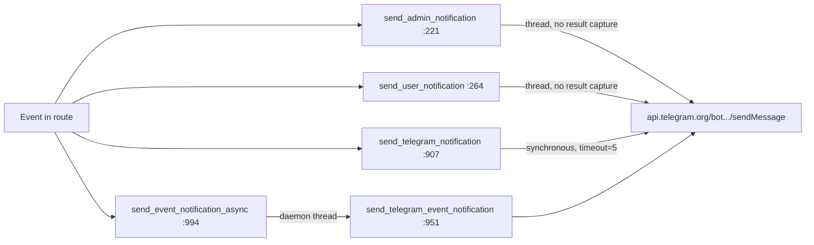

# 05 — Integrations and Operations

---

## 1. Telegram Bot API

### 1.1 Config sources (three separate paths)

| Helper | Config source | Used by |
| --- | --- | --- |
| `get_admin_notifications_config()` `:206-219` | `ADMIN_TELEGRAM_BOT_TOKEN`, `ADMIN_TELEGRAM_CHAT_ID` env vars | `send_admin_notification()` `:221-238` |
| `get_telegram_credentials(username)` `:304-322` | `data.json → portfolios.<username>.notifications.telegram` only; **explicitly no fallback** | user notification helpers `:264-293,907-1009` |
| Direct form input | `bot_token`/`chat_id` from settings POST `:2334-2397` | saves to JSON after live `getMe` + `sendMessage` test |

`load_telegram_config()` `:296-301` duplicates the admin env read but is never called. Startup constants `TELEGRAM_BOT_TOKEN`, `TELEGRAM_CHAT_ID`, `TELEGRAM_ENABLED` (`:325-327`) are computed from `get_telegram_credentials()` with no username — which always returns `(None, None)` — so **`TELEGRAM_ENABLED` is always False and unused**.

### 1.2 Send paths



- Message payloads use `parse_mode='HTML'` and interpolate user-controlled `name`, `email`, message body, company, and client notes into HTML without escaping (`:921-931`, `:1058-1085`, `:1407`, `:1759`, `:3339-3343`, `:3394-3400`). Telegram will reject malformed markup; crafted input can alter message structure. No external message was sent during this audit.
- Admin SMTP inner thread contains `except: pass` (`:258`) — total failure invisibility.
- No retry, no queue, no idempotency key, no delivery log. Duplicate submissions produce duplicate notifications.
- `dashboard_telegram()` `:2346-2364` performs real `getMe` and `sendMessage` calls synchronously on settings save; `telegram_test_connection()` `:2484-2518` sends a real test message.
- Per-user token/chat ID are stored plaintext in `data.json` (`:2377-2381`). Settings view passes a partially obfuscated token to the template (`:2305-2309`); the raw value remains in the document.

### 1.3 Verified event coverage

Covered: platform inquiry (`:1409`, `:1770`), portfolio inquiry (`:1767`), verification changes (`:818-832`), access-level change (`:866-870`), password change (`:3470-3473`), login (`:2019-2046`), new lead (`:3337-3344`), client status change (`:3393-3400`), backup created/restored (`:1898-1932`).
Not covered: internal messages/replies, project add/update (templates exist at `:963-970` but never called), visitor arrivals (`:1178` explicitly disabled).

---

## 2. SMTP email

### 2.1 Config resolution

`load_smtp_config(username)` `:331-357`:
1. If username given, read `data.json → portfolios.<username>.notifications.smtp`; require host/email/password.
2. Otherwise (or on failure) read global `smtp_config.json` if present.
3. Return `{}` if nothing found.

`save_smtp_config()` `:360-368` can write `smtp_config.json` but is never called; per-user settings are saved directly into `data.json` by `dashboard_smtp()` `:2400-2436`. The global file is absent in this snapshot.

### 2.2 Send implementations

| Function | Behavior |
| --- | --- |
| `send_email()` `:371-402` | builds `MIMEMultipart('alternative')`, `starttls()`, `login()`, `send_message()`; sync; returns bool; logs exceptions |
| `send_admin_notification()` SMTP branch `:241-262` | admin env config, HTML body, separate thread, inner bare `except: pass` |
| `send_confirmation_email()` `:1585-1653` | custom HTML, global config, called nowhere |
| Inline block in `contact_academy()` `:1411-1416` | separate `send_email()` call using global config + `ADMIN_EMAIL` |
| Inline block in `contact()` `:1630-1648` | duplicate raw SMTP code for visitor confirmation via global config only |

`email_test_connection()` `:2439-2481` sends a real test email via `send_email()`.

### 2.3 Issues

- Five separate SMTP code paths with different recipients/config resolution; results are not recorded anywhere.
- `starttls()` is unconditional; servers using implicit TLS or no TLS will fail.
- No timeouts on `smtplib.SMTP(...)` construction — a hanging server can block a request thread indefinitely (except in the admin threaded path).
- Credentials stored plaintext in `data.json` and (if ever created) `smtp_config.json`.
- No notification preferences beyond "configured or not"; no per-event opt-in/out, no quiet hours, no unsubscribe, no bounce handling.

---

## 3. Internal notifications

There is **no notification table**. "Notifications" are a live query over unread `Message` rows plus a client-side poll:

1. Server renders badge from `get_unread_messages_count()` `:1090-1115` via context processor `:82`.
2. `base.html:237` polls `/dashboard/notifications/latest` (`:1117-1154`) every 30 s (`:307`).
3. JS replaces the badge with `data.length` (`:245-267`) and builds dropdown links (`:276-301`).

Known inconsistencies are documented in `03_FEATURE_LIFECYCLE.md §C.5-6`: different filters for admin (no replies in count, replies included in list), member counts include every unread reply, and the server-rendered count is overwritten. There is no mark-read API (`read_message` missing), no polling pause, no "mark all read", and no persistent notification history.

---

## 4. Background operations

### 4.1 Scheduler configuration

```python
scheduler = BackgroundScheduler()   # app.py:120
scheduler.start()                   # app.py:121  (at import time)
atexit.register(lambda: scheduler.shutdown())  # app.py:122

scheduler.add_job(scheduled_backup, 'cron', hour='*', minute=0,
                  id='daily_backup', name='Hourly backup',
                  replace_existing=True)         # app.py:608-614
scheduler.add_job(reset_demo_data, 'cron', hour='*', minute=0,
                  id='demo_reset', name='Demo data hourly reset',
                  replace_existing=True)         # app.py:616-622
```

- The job ID `daily_backup` and display name `Hourly backup` disagree with each other; actual schedule is hourly.
- `reset_demo_data()` is `pass` (`:603-605`) — a no-op job running every hour.
- `replace_existing=True` only deduplicates jobs within a single scheduler instance. Under Gunicorn with 4 workers (`render.yaml:6`), each worker imports `app.py` and starts its own scheduler → up to four concurrent hourly backups writing the same timestamped file and `backups.json` (INFERENCE; not runtime-tested due to side effects).
- APScheduler uses its own thread pool; no job store, no coalescing configuration, no misfire grace time, no max-instances.
- Failures are caught and logged (`:599-600`); no alerting, retry, or health check.
- On process restart, all jobs start fresh; no record of last successful run beyond files in `backups/`.
- No shutdown hook for threads created by notification helpers (they are plain `threading.Thread`, mostly non-daemon in `send_admin_notification`/`send_user_notification`).

### 4.2 Backup job specifics

See `04_DATABASE_AND_DATA_LIFECYCLE.md §7`. It copies only `data.json`, retains 20 files, and relies on local filesystem persistence.

---

## 5. Deployment and runtime

### 5.1 Deployment descriptors

| File | Content | Assessment |
| --- | --- | --- |
| `render.yaml:1-17` | Python web service, `./build.sh`, Gunicorn 4 workers/120 s/`--reuse-port`, `PYTHON_VERSION=3.11.0`, generated `SESSION_SECRET`, required `DATABASE_URL`, `ADMIN_USERNAME=admin`, generated `ADMIN_PASSWORD` | No `FLASK_ENV` → DevelopmentConfig/DEBUG; no persistent disk; no admin notification env vars |
| `Procfile:1` | `web: gunicorn app:app` | Inconsistent with Render command (no workers/bind/timeout) |
| `build.sh:1-12` | `pip install --upgrade pip`; `pip install -r requirements.txt`; `mkdir -p static/assets/uploads` | Does not create `backups/` or `security/` explicitly, but `app.py` does at import |

### 5.2 Process/environment baseline

- No `.env` file; `python-dotenv` is installed but unused.
- No `DATABASE_URL`/`PG*`/secret variables in the audit shell; local fallback would be SQLite `codexx.db` (no such file present).
- Global app config is partly re-declared in `app.py:88-96`, overriding `config.py`.
- Logging uses Flask's default logger with `app.logger.*` calls; no log rotation, format, level, or aggregation configured outside the runtime.
- Error handlers: 403/404/500/503 render templates; 413 flashes and redirects to the same URL (risk of redirect loop if oversized body persists).

### 5.3 Static and uploaded files

- Static path: Flask default `static/` with CSS, JS, themes, images, favicons.
- Upload folder: `static/assets/uploads` (`config.py:39`, `app.py:90,116`) — served publicly by Flask's static route.
- Uploads are validated by extension only; no MIME sniffing, no content scanning, no per-user subdirectories.
- `robots.txt` route (`:1851-1871`) disallows `/static/`, which conflicts with the fact that all themes/images are under `/static/`; search engines may still crawl them via direct links. It also shadows the physical `static/robots.txt` file.
- `favicon` route (`:1874-1877`) serves the file directly; three favicon variants exist.

### 5.4 Security controls — actual state

| Control | Implementation | Verdict |
| --- | --- | --- |
| Password hashing | `generate_password_hash`/`check_password_hash` (Werkzeug scrypt) `:5,2084,2029` | VERIFIED present |
| Session cookies | HttpOnly, SameSite=Lax, 7 days; **Secure=False** `:93-95` | PARTIAL — cookie transmitted over HTTP if TLS terminates elsewhere misconfigured |
| Secret key | env with hard-coded fallback `config.py:8` | WEAK |
| CSRF | None — no token library or hidden token fields found | ABSENT |
| Rate limiting | In-process dict `RATE_LIMIT_REQUESTS` `:126-164`, applied only in `/contact` `:1665`; key from client-controlled `X-Forwarded-For` `:135-138` | WEAK / bypassable |
| IP logging | JSON file, 1000-entry cap, written on login/contact events `:167-194` | PARTIAL; plaintext personal data |
| Authorization | Session flags; no ownership checks on reply/delete-by-ID; no workspace filters | WEAK |
| Destructive methods | Message/client/user-profile deletion and conversion via GET; no CSRF | WEAK |
| Input validation | Ad hoc trims/slices; skills level normalization; no central schema | PARTIAL |
| XSS | Jinja autoescaping on templates; inline JS uses `innerHTML` with server JSON in `base.html:288-299` and `settings.html:737-789`; Telegram HTML interpolation unescaped | PARTIAL / risk |
| SQL injection | SQLAlchemy ORM/query builder used throughout; `text('SELECT 1')` is constant | VERIFIED low risk |
| Security headers | CSP wildcard (`default-src *`, `script-src * 'unsafe-inline' 'unsafe-eval'`, `frame-ancestors *`), `nosniff`, HSTS `:3552-3565` | CSP effectively permissive; no X-Frame-Options |
| File path safety | `secure_filename()` on backup filenames and uploads `:1916,1945,1967,2537,2628`; backup path joined to fixed `backups/` dir | VERIFIED reasonable for path traversal |
| Secrets handling | Plaintext in `data.json`; partial obfuscation in settings UI; no vault | WEAK |

`replit.md:45-51` claims CSRF protection, X-Frame-Options, and effective CSP — **not supported by code**.

### 5.5 Frontend external dependencies

CDN references observed in templates: Bootstrap 5.1.3 JS (`base.html:210`), Font Awesome, Google Fonts, Bootstrap CSS in public pages. No SRI hashes observed. Offline/air-gapped deployments will lose styling/icons/JS behavior.

### 5.6 PDF generation

`/download-cv` `:3517-3548` lazily imports WeasyPrint, renders `cv_preview.html` with `pdf_mode=True`, writes to an in-memory buffer, and returns a PDF. `requirements.txt:11` pins WeasyPrint 65.1. System-level native libraries required by WeasyPrint are not declared in `build.sh`; local success is UNKNOWN.

---

## 6. Operational risk register

| ID | Risk | Severity | Evidence |
| --- | --- | --- | --- |
| OPS-01 | DEBUG defaults on in production config selection | High | `config.py:50-53,77-80`; `render.yaml` has no `FLASK_ENV` |
| OPS-02 | Per-worker schedulers cause duplicate hourly backups | High | `app.py:119-122,608-614`; `render.yaml:6` (INFERENCE) |
| OPS-03 | Local-FS backups/uploads/IP log not persistent or shared | High | `app.py:39,90,117,131`; no volume in `render.yaml` |
| OPS-04 | No CSRF; several GET state changes | High | route inventory; `02_ARCHITECTURE_MAP.md §3` |
| OPS-05 | Permissive CSP; `SESSION_COOKIE_SECURE=False` | Medium/High | `app.py:3554-3564`, `:93` |
| OPS-06 | Notification sends unobserved; no retries/dedup/audit | Medium | `app.py:221-293,907-1009` |
| OPS-07 | SMTP calls without timeout can block request threads | Medium | `app.py:393,1639` |
| OPS-08 | Rate limit bypassable via header and not shared across workers | Medium | `app.py:135-164` |
| OPS-09 | No logging config/rotation/alerting | Medium | `app.logger.*` only |
| OPS-10 | CDN dependencies without SRI | Low/Medium | template `<link>`/`<script>` tags |
| OPS-11 | Admin notification env vars absent from deployment descriptor | Medium | `render.yaml:7-17` vs `app.py:206-219` |
| OPS-12 | Duplicate/unpinned dependencies create non-reproducible builds | Medium | `requirements.txt:17-53` |
| OPS-13 | Destructive/test endpoints can send real messages if called | Medium | `:2334-2397,2439-2518` (not invoked during audit) |

---

**Next document:** `06_TECHNICAL_DEBT.md` — consolidated, severity-ranked findings with exact evidence, impact, recommended action, and fix dependencies.
