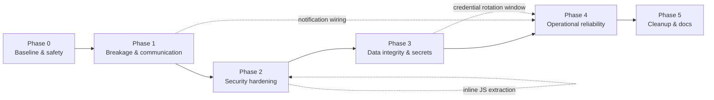

# 07 — Recommended Action Plan (Bounded, Prioritized, Phased)

**This is a plan only. No implementation has been performed.** Each phase is intentionally small enough to review and roll back independently. Business logic is preserved wherever possible; no rewrite is recommended.

---

## Guiding constraints

1. Establish a reproducible baseline before changing code.
2. Never remediate against the only copy of production data; work from a verified isolated copy.
3. One concern per phase; no "while we are here" changes.
4. Keep existing URLs, flash messages, and template behavior unless the phase explicitly changes them.
5. Every phase ends with evidence: diff review, isolated verification, and rollback note.
6. External integrations (Telegram/SMTP) must be tested with stubbed transports, never live sends.

---

## Phase 0 — Baseline and safety (independent; do first)

**Goal:** make further work attributable and reversible.

| Item | Action | Evidence / acceptance |
| --- | --- | --- |
| 0.1 | Initialise or locate the real Git repository; record remote, branch, commit; commit the current tree unchanged as the audit baseline | `git status` clean at baseline; commit SHA recorded in audit addendum |
| 0.2 | Take file-level snapshots of `data.json`, `security/ip_log.json`, `static/assets/uploads/`, and (if present in target) the DB and `backups/` | Checksums recorded; snapshots stored outside the app directory |
| 0.3 | Inventory deployed environment variables (names only, never values) and compare with `render.yaml`, `config.py`, `app.py:206-219` | Written matrix of present/missing/expected vars |
| 0.4 | Create an isolated copy of project + DB for all subsequent verification | Isolated app starts without touching production paths |
| 0.5 | Add a minimal test harness that avoids import-time side effects (or a test config that disables scheduler and redirects data paths) | A test can import app code without creating scheduler threads or writing production files |

**Risk if skipped:** every later change is un-attributable; rollback impossible.
**Rollback:** none needed (read-only plus new files).

---

## Phase 1 — Active breakage and communication correctness (highest value)

**Goal:** fix things that are demonstrably broken or inconsistent. Communication work must satisfy the approved policy in `08_COMMUNICATION_BUSINESS_RULES.md`: member↔administration only, member-to-member blocked at the backend, and archiving instead of permanent deletion. The "without changing data model" constraint applies to all items **except** the durable archive-state decision in 1.8, which requires explicit product-owner approval before any implementation (`08` §4 and risk C-01).

| Item | Action | Files / refs | Acceptance / verification method |
| --- | --- | --- | --- |
| 1.1 | Replace `url_for('login')` with `dashboard_login` | `app.py:730` | `/register` redirects to login page, no 500 |
| 1.2 | Fix `internal_view.html` timestamp to use `created_at` | `templates/dashboard/internal_view.html:36` | Thread page shows a date |
| 1.3 | Define one canonical unread-count query and reuse in `get_unread_messages_count`, `get_latest_notifications`, and dashboard stats | `app.py:1090-1154,2201-2205`; `base.html:136,245` | Badge, dropdown length, and overview agree for seeded threads/replies |
| 1.4 | Implement explicit read-state endpoint (`read_message` or equivalent) with participant authorization; wire bell items and thread view to it | new route near `:1117`; `base.html:276-301`; `dashboard_internal_view():3014-3018` | Opening a notification clears exactly that message/thread; counter updates on next poll |
| 1.5 | Mark replies read when a thread is opened (or define explicitly that only parents count) | `app.py:3021-3031` | No permanent unread residue after reading a thread |
| 1.6 | Define one canonical administration identity, then validate `receiver_id` in `dashboard_internal_send` and `dashboard_internal_compose`; reject self-send, unknown IDs, and **all member→member sends at the backend** (hidden fields and URL parameters are not boundaries) | `app.py:2011-2034,2913-2919,2927-2985`; `internal_compose.html:18`; `internal_messages.html:17` | Member POST to another member ID rejected with no row persisted (criterion 3); member GET of member-targeted compose URL rejected |
| 1.7 | Add participant check to `dashboard_reply_message` | `app.py:1272-1308` | Outsider reply attempt redirected with flash; no row persisted |
| 1.8 | Rewire "Archive Thread" to a durable archive action that **preserves the root message, all replies, sender/receiver relationships, and timestamps**; make it POST + CSRF; remove the hard-delete path. Do **not** implement any of the four unapproved semantics in `08` §5 until the product owner decides them | `internal_view.html:75-79`; `app.py:3121-3163`; `08` §4–5; TD-08 | Blocked pending approval of archive semantics and state location. After approval: archive a thread with ≥2 replies; all rows unchanged; no `db.session.delete` on message routes; hidden from active inbox per approved semantics |
| 1.9 | Add internal-message/reply notification dispatch after commit (stub transport in tests) | `app.py:2950-2987,1294-1308` | Exactly one notification per new message/reply to the other party, with recipient resolved from validated conversation participants |
| 1.10 | Add a working administrator-initiated conversation path (server-side member picker limited to `User` rows + reachable compose UI), using the canonical admin identity so admin messages do not carry `sender_id='None'` | `app.py:1257-1266,2913-2919,2956,2978`; `chat_list.html:22`; `user_profile.html:18,42` (unreferenced) | As admin (env-admin and JSON-admin variants), start a thread with any member; member sees and can reply to it |
| 1.11 | Apply the authorization matrix to **every** communication route: view, reply, archive, convert, notification poll, and unread helper — not only compose/reply | `08` §3.2; `app.py:2780-2856,2998-3118,3121-3232,1117-1154,1246-1266` | Member A cannot view/reply/archive/convert member B's thread by forged ID; admin override is explicit and role-checked; notification poll is authenticated and participant-scoped |
| 1.12 | Authenticate `/dashboard/notifications/latest` and minimize its payload so no content excerpt or recipient identity reaches an unauthorized principal; update the polling JS in the same change | `app.py:1117-1154`; `base.html:237-309` | Anonymous request carries no data via an auth boundary (not incidental `[]`); cross-user poll returns no other party's content; no live sends |

### Phase 1 communication acceptance gate

Communication-related work cannot be accepted unless **all** ten criteria below are verified in an isolated copy. Full verification methods are in `08_COMMUNICATION_BUSINESS_RULES.md` §6.

| # | Criterion (from `08` §6) | Verification method |
| --- | --- | --- |
| 1 | Members can initiate conversations with administration | Persist a root internal `Message` with correct `sender_role`/`receiver_id` and redirect to thread |
| 2 | Administrators can initiate conversations with any member | Admin (both identity variants) picks a member; persisted row uses validated member ID and non-`'None'` admin sender; member can reply |
| 3 | Member-to-member blocked at backend | Member send/URL attempts to another member ID rejected with no row persisted |
| 4 | Both participants can exchange replies | Member→admin and admin→member replies persist with correct `parent_id`/`receiver_id`; outsider reply rejected |
| 5 | Ownership and access verified server-side | Execute `08` §3.2 route matrix with member A, member B, and admin credentials; forged IDs denied |
| 6 | Read/unread state consistent | Seeded thread with replies: badge, poll list, thread view, and overview agree; read-state endpoint updates only the approved set |
| 7 | Notifications do not expose content or recipient data | Stubbed transports; authenticated, participant-scoped poll; no cross-user payload fields; no live sends |
| 8 | Archiving preserves complete history | Archive thread with ≥2 replies; root/replies/relationships/timestamps intact; hidden per approved semantics |
| 9 | No permanent deletion | Source scan shows no message-route hard delete; POST + CSRF; row counts unchanged after archive |
| 10 | Unrelated functionality unaffected | Regression pass over portfolio CRUD, public pages, login, user admin, and backups against pre-change baseline |

**Dependencies:** 1.3 must precede 1.4, 1.5, and 1.12; canonical admin identity (1.6) must precede 1.9, 1.10, and 1.11. **1.8 is blocked** until the product owner approves the four archive semantics in `08` §5 and the archive-state location in `08` §4 — no option may be selected during implementation.

**Risk:** changing counter semantics will change user-visible numbers; announce or document. Additionally, archive state may require a reviewed persistent-state addition and a baseline migration (risks C-01, C-04, C-05, C-10 in `08` §8). Do not run live Telegram/SMTP sends.

**Rollback:** phase is isolated to a handful of routes/templates; revert commit. Any archive-state schema addition must have its own reviewed rollback note before it is applied.

---

## Phase 2 — Security hardening that does not change architecture

**Goal:** remove the highest-impact security weaknesses while keeping behavior stable.

| Item | Action | Refs | Acceptance |
| --- | --- | --- | --- |
| 2.1 | Add CSRF tokens to all POST forms (or a global library) and convert state-changing GET routes to POST | route inventory; `app.py:2161,3124,3169,3428`; `user_profile.html:112` | GET on those URLs no longer mutates state |
| 2.2 | Add `login_required` to `/dashboard/notifications/latest` and guard missing `created_at` | `app.py:1117-1154` | Anonymous call returns 401/redirect; legacy rows do not blank the list |
| 2.3 | Centralize ownership checks for message view/reply/delete/backup download (sender, receiver, admin, workspace) | `app.py:1940-1958,3004-3012,3051-3068,3076-3093,3131-3137` | Cross-user ID access denied in isolated tests |
| 2.4 | Set `SESSION_COOKIE_SECURE` from environment (default on in production), require `SESSION_SECRET` in production, remove hard-coded fallback use | `config.py:8,10`; `app.py:93` | Production config must fail fast if secret missing; no HTTP cookie in prod test |
| 2.5 | Tighten CSP only after moving/noncing inline scripts; add X-Frame-Options and Referrer-Policy | `app.py:3552-3565`; `base.html:212-309`; `settings.html:640-789`; `index.html:499+` | No CSP violations in browser smoke test of all main pages |
| 2.6 | Escape user-controlled content in Telegram HTML payloads | `app.py:921-931,1058-1085,1407,1759,3339-3400` | Stub transport receives escaped text for hostile input |
| 2.7 | Apply trusted-proxy parsing to `get_client_ip()`, rate-limit login and test endpoints, use shared store if feasible | `app.py:135-164,2003,2439,2487` | Spoofed header ignored; repeated login attempts throttled |

**Dependencies:** 2.5 depends on externalising inline JS (can be split into 2.5a/b). 2.3 depends on ID semantics decided in Phase 1/3.
**Risk:** CSRF rollout can break cached forms; coordinate template changes in one commit.

---

## Phase 3 — Data integrity and secret handling

**Goal:** stop silent divergence and protect credentials; no wholesale rewrite.

| Item | Action | Refs | Acceptance |
| --- | --- | --- | --- |
| 3.1 | Make JSON writes atomic (temp file + `os.replace`) and add a lock; stop writing on public GET where possible | `app.py:411-470,1157-1203` | Concurrent writer simulation in isolated copy loses no updates |
| 3.2 | Declare one authoritative store for credentials/roles; reconcile JSON↔DB user IDs and password hashes with a reviewed one-off script on a copy | `app.py:2029-2047,2081-2149,3492-3494`; `models.py:32` | Login works from authoritative store; no stale hash remains |
| 3.3 | Complete user deletion cleanup (DB rows, messages, uploads, log references) or introduce soft-delete | `app.py:877-904` | No orphan DB rows after deletion in isolated copy |
| 3.4 | Move notification secrets out of `data.json` into env/vault; redact secrets from backups and downloads; rotate exposed credentials | `app.py:2373-2382,2417-2428,1940-1958` | No plaintext tokens in `data.json` or backup downloads after migration |
| 3.5 | Reconcile orphan portfolios and verification defaults | `data.json`; `app.py:481-483,1543-1582` | No landing card leads to 404; catalog policy documented |
| 3.6 | Add FKs/indexes for `Message.sender_id`, `receiver_id`, `parent_id` via reviewed migration; normalize ID type | `models.py:79-81` | Migration applies cleanly to copied production-shaped DB; queries use indexes |
| 3.7 | Introduce Alembic baseline revision; freeze schema changes during migration work | `requirements.txt:14`; `app.py:36-41` | `alembic upgrade head` works on a fresh DB and on a copy of the live DB |

**Dependencies:** 3.2 before 3.6 (ID normalization); 3.4 requires credential rotation window; 3.7 should precede 3.6 so the FK change is captured as a revision.
**Risk:** this is the highest-risk phase — every step runs first on a copy with a restore drill.

---

## Phase 4 — Operational reliability

**Goal:** make background jobs and deployment deterministic.

| Item | Action | Refs | Acceptance |
| --- | --- | --- | --- |
| 4.1 | Set `FLASK_ENV=production` in deployment; fail startup if DEBUG in production; remove `debug=True` from local main entry | `render.yaml`; `config.py:50-53,77-80`; `app.py:3568-3570` | Deployed config reports DEBUG=False |
| 4.2 | Remove no-op demo reset job; move backup scheduler to a single dedicated process or add distributed lock + `max_instances=1` | `app.py:603-622,119-122` | Exactly one backup per hour in a 4-worker smoke environment |
| 4.3 | Expand backups to cover DB dump + uploads manifest + configs; store off-instance; validate restore with a drill | `app.py:507-622,1910-1937`; `render.yaml` | Restore drill recreates a working isolated instance |
| 4.4 | Validate backup file before overwrite; register recovery files in metadata and retention | `app.py:1916-1932,575-590` | Corrupt backup is rejected; recovery files visible/pruned |
| 4.5 | Add timeouts and background dispatch to all SMTP/Telegram sends; add retry + delivery log with dedup key | `app.py:221-402,907-1009` | Stubbed provider failure logged and retried bounded times; no duplicate keys |
| 4.6 | Provision all required env vars in deployment descriptor; clean `requirements.txt` to one pinned block and remove truly unused packages (keep Alembic) | `render.yaml:7-17`; `requirements.txt:1-53` | Reproducible install; startup config validation passes |
| 4.7 | Add structured logging, rotation, and alerting on scheduler/notification failures | `app.logger.*` throughout | Failed job produces a detectable alert in test |

**Dependencies:** 4.2 depends on deployment topology decision; 4.3 depends on 0.2 snapshot procedure; 4.5 should follow Phase 1 notification wiring.
**Risk:** changing scheduler topology can pause backups temporarily — schedule during low-traffic window.

---

## Phase 5 — Dead code, documentation, and consolidation (last)

**Goal:** reduce confusion after behavior is stable and verified.

| Item | Action | Refs | Acceptance |
| --- | --- | --- | --- |
| 5.1 | Remove unreachable blocks and no-op helpers | `app.py:1360-1364,3106-3118,1481-1483,296-301,360-368,1012-1087,1212-1219,603-605` | No behavior change in isolated regression pass |
| 5.2 | Remove deprecated chat routes/templates and unreferenced templates if no external links exist | `app.py:1250-1266`; `chat.html`, `chat_list.html`, `subscription.html`, `user_profile.html`, `public_base.html`, `400.html` | Link check passes; 404s intentional and documented |
| 5.3 | Consolidate duplicate config and notification helpers | `app.py:88-96,206-402,907-1009`; `config.py` | One config source, one notification adapter per channel |
| 5.4 | Fix or remove broken SEO/help routes | `app.py:1803-1871,2227-2235` | Sitemap URLs resolve; `/documentation` renders or is removed |
| 5.5 | Incrementally extract domains into Blueprints/services without changing URLs or business rules | `app.py` monolith | Each extracted domain keeps identical routes and flash messages |
| 5.6 | Update `README.md`, `replit.md`, `audit_plan.md` to reflect verified implementation after each fix | docs | No remaining "completed" claim without corresponding code |

**Dependencies:** all earlier phases.
**Risk:** premature deletion of legacy code can remove the only working fallback; keep one release cycle of deprecation.

---

## Phase dependency overview

Phases 1 and 2 can partially overlap after Phase 0, but Phase 3 must not begin until identity semantics are settled in Phase 1/2. Phase 5 is strictly last.

---

## Explicit non-goals for this remediation cycle

- No full framework rewrite.
- No immediate replacement of Flask/Jinja/SQLAlchemy.
- No deletion of `data.json` legacy readers before DB parity is proven.
- No change to portfolio/public visual design beyond fixing broken links/timestamps.
- No live Telegram/SMTP test sends.
- No migration or schema change executed against the original database.

---

**Next document:** `FINAL_ASSESSMENT.md` — overall maturity, answers to the nine review questions, unresolved questions, and the single recommended next step.
