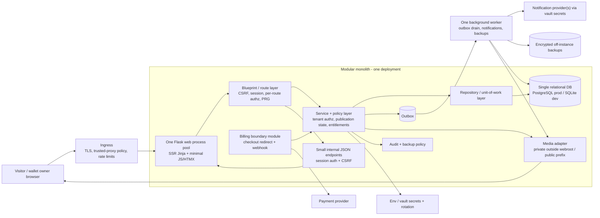

# Codexx Wallet — Architecture Decision: Core Reconstruction

This is a decision-quality assessment for product-owner approval. It is not an implementation plan and does not change application source, data, or configuration.

## 1. Decision statement (DECISION)

Adopt **Option A′: Modular Monolith, Server-Rendered Flask**.

Option A′ is a **controlled reconstruction of the core**: one Flask application factory, Blueprints/modules, a service layer, a repository layer, and one relational database. It is explicitly **not** a feature-by-feature port of the current app and **not** a big-bang greenfield rewrite of everything.

Non-negotiables carried by this decision:

- Product definition: **Codexx Wallet** is a paid, customer-owned professional digital wallet and private workspace. It is not a financial wallet, marketplace, social network, CRM, or LMS.
- Public wallet pages are presentation; the private workspace is the real product value.
- No wallet concept exists in the current code/data/docs today; “Silver” is a CSS theme and “premium” is style/entitlement language only.
- Remove internal member-to-member messaging, threads/inbox/compose/reply/read-state/unread polling, deprecated chat, false “archive” delete, and member-to-member policy. Replace them with **one-way Administration → wallet-owner Announcements** with append-only records and per-recipient read receipts.
- One deployment, one web process pool, and exactly one separate background worker for backups, notifications, and outbox delivery.
- PostgreSQL in production, SQLite for local development, Alembic migrations, one transactional source of truth, no JSON operational store.
- No public REST API in v1. The frontend/backend contract is an internal module boundary plus a small set of session-authenticated, CSRF-protected JSON endpoints for progressive enhancement.
- Billing exists only at a boundary module: checkout redirect plus webhook. There is no financial wallet logic.

## 2. EVIDENCE — findings about the current app

The evidence below describes the inspected current application. It is separate from the decision that follows.

| Area | Observed fact | Source |
|---|---|---|
| Structure | `app.py` is 3,570 lines with 72 `@app.route` declarations. No Blueprints, application factory, service layer, repository layer, tests, migrations, or CI. Importing the module is state-changing: `db.create_all()`, directory creation, and scheduler start. | `[AUDIT/02 §3]`, `app.py:1-3570` |
| Data model | `models.py` is 91 lines with 7 models (`Workspace`, `User`, `Project`, `Skill`, `Client`, `Message`, `VisitorLog`), FK columns declared but no ORM relationships, no cascade rules and no secondary indexes. `Message.workspace_id` is nullable; `sender_id`, `receiver_id`, and `parent_id` are unconstrained strings. | `[AUDIT/04 §2]`, `models.py:1-91` |
| Persistence split | `data.json` is authoritative for most concepts; SQL is authoritative for messages. There is no transaction spanning the two stores. | `[AUDIT/05 §1]`, `data.json`, `models.py` |
| Identity | 3 users, integer IDs, `role=user`, no `is_verified`. `/register` returns 500. | `[AUDIT/06 §4]` |
| Product vocabulary | No wallet concept exists in code, data, or docs. “Silver” is a CSS theme; “premium” is style/entitlement language. | `[DISCOVERY/01 §3]`, `[DISCOVERY/06 §1]`, `[DISCOVERY/09 §7]` |
| Security | No CSRF protection; GET mutations exist; CSP uses `default-src *` and `frame-ancestors *`; no `X-Frame-Options`; `X-Forwarded-For` is trusted; `SESSION_COOKIE_SECURE=False` is re-forced at `app.py:93`; config has a secret fallback; `render.yaml` runs 4 Gunicorn workers without `FLASK_ENV`, making debug active in production. | `[AUDIT/05 §5.4]`, `[AUDIT/06 §2]`, `[AUDIT/01 §5.2]`, `config.py`, `app.py:93`, `render.yaml` |
| Messaging | Four conflicting unread definitions, no internal notifications, unvalidated `receiver_id`, reply without participant check, unauthenticated poll, blank date, no admin-initiation UI. The live “Archive” action flashes success but deletes nothing. | `[AUDIT/08 §2]`, `[AUDIT/03 §C]`, `[DISCOVERY/05 §4.2, §4.4]` |
| Delivery and operations | Four Telegram paths and five SMTP paths, unescaped HTML, no retry/dedup/audit. Any logged-in user can download backups. Uploads validate extension only. | `[AUDIT/05 §2, §4.2]`, `[AUDIT/04 §7]` |
| Frontend | 49 templates, 6 tiny theme CSS files, mixed Bootstrap, zero Arabic/RTL. `/documentation` 404s, sitemap references a nonexistent `/project/<id>`, 403/503 templates extend a missing `base.html`, 5 orphan templates including `subscription.html` with a missing `url_for('payment')`. | `[AUDIT/02 §6.1]`, `[DISCOVERY/08 §1]`, `[DISCOVERY/09 §4]` |
| Runtime | Live CDP check passed 23/23 with 0 console errors and 27 screenshots; observed 404/500 responses were expected. Theme persisted, inquiry was dual-written, notification delivery was unproven, and demo writes were allowed. | `[DISCOVERY/05 §1, §4]` |
| Prior guidance | Prior audit/discovery material recorded a “no rewrite” preference. | `[DISCOVERY/10 §2]`, `[DISCOVERY/12 §1]`, `[AUDIT/FINAL_ASSESSMENT §6]` |

## 3. Why the prior “no rewrite” premise changed (DECISION)

The prior “no rewrite” guidance was reasonable for the question it answered: **can the existing demonstration app be kept alive rather than rewritten for its own sake?** That premise is invalidated by the new commercial and tenant-isolation mandate.

The new mandate adds requirements the current design cannot satisfy safely:

- A paid, customer-owned product with real tenant boundaries, not a demo app with shared identity shortcuts.
- Authorization on every sensitive operation, with `wallet_id` owned by the session and never supplied by the client.
- Entitlements separated from core workspace behavior through Plan, Subscription, and policy services.
- One transactional database instead of `data.json` plus SQL dual writes.
- CSRF on all mutations, no GET mutations, strict CSP, secure cookies, startup secret validation, and audited admin actions.
- One-way administrative announcements replacing dead and unsafe member-to-member messaging.
- Arabic/RTL as a v1 requirement, while the current source has zero Arabic/RTL support.

Patching the current app feature by feature would carry forward dual persistence, identity chaos, missing CSRF, permissive CSP, and dead messaging machinery into a paid product. That is not a safer path than reconstruction.

This is still **not** a greenfield rebuild of everything. The following are preserved as design references and product vocabulary:

- Public profile and project presentation UX.
- The six theme CSS files.
- The inquiry taxonomy and inquiry UX.
- The Werkzeug-compatible password-hashing approach.
- The Jinja template hierarchy.
- The existing public URL shape.
- The backup concept, rebuilt with restricted access, encryption, and tested restore.

The decision is therefore: **reconstruct the core deliberately; preserve the product vocabulary and UX references; drop the unsafe machinery.**

## 4. Options evaluated (DECISION)

Scale: 1 = weak, 5 = strong. For “complexity,” a higher score means lower cognitive and operational complexity.

| Criterion | A: Preserve / restructure current Flask app | B: Python API + React SPA | C: Alternatives: Django / FastAPI+HTMX / serverless-jamstack | A′: Modular monolith, SSR Flask — chosen |
|---|---:|---:|---:|---:|
| Maintainability | 2 — 3,570-line `app.py`, no module boundaries | 3 — clean split but two codebases | 3 — Django strong, FastAPI+HTMX strong, serverless weak | 4 — bounded modules, service/repository layers |
| Security and tenant isolation | 1 — no CSRF, permissive CSP, shared identity shortcuts | 3 — possible, but token storage adds XSS surface | 3 — framework defaults help, but boundaries still must be designed | 5 — session auth, CSRF, policy service, `wallet_id` constraints |
| Complexity, higher = simpler | 2 — dual stores and dead paths remain | 2 — two deployments, CORS, tokens, async contract drift | 3 — Django coherent, FastAPI+HTMX moderate, serverless split | 4 — one codebase, one DB, one worker |
| Development cost, higher = lower cost/risk | 2 — patching chaos is expensive over time | 2 — new build pipeline and frontend hiring/ops burden | 3 — team fit varies | 4 — reuses Python/Flask/Jinja strengths and narrow scope |
| Deployment and operations | 2 — 4 workers, no persistent disk, inconsistent Procfile | 2 — web + API + frontend build/deploy | 3 — Django good, serverless poor for private workspace | 5 — one deployment, one web pool, one worker |
| Long-term commercial value | 1 — unsafe as paid tenant product | 3 — viable but unjustified for this scope | 3 — viable but no decisive advantage | 5 — tenant-safe, entitlement-ready, SEO-friendly |
| **Total** | **10/30** | **15/30** | **18/30** | **27/30** |

Option C is shown as a family score. Django would be a credible alternative but offers no decisive gain over the team’s existing Flask/Jinja competence and the requirement to preserve URL and template vocabulary. FastAPI+HTMX is the closest alternative but requires a framework swap without a product requirement that demands it. Serverless/jamstack is a poor fit for secure private workspaces, cookie sessions, backup workers, and a single transactional source of truth.

### Rejection of Option B: Python API + React (DECISION)

Option B is rejected for v1:

- There is no evidence of need for a rich client-side application.
- Public wallet pages are content and SEO-oriented, where server-rendered HTML is superior.
- The private workspace is form and table CRUD, not rich collaborative state.
- React adds a build pipeline, a second deployment, CORS/token handling, token-storage XSS surface, and extra operations/hiring burden.
- The team already has Python/Flask experience.
- Scope is explicitly narrow; a second frontend stack is disproportionate.

**Revisit trigger:** reconsider React only if a genuinely interactive designer becomes a committed requirement, for example a drag-and-drop canvas, multi-user realtime collaboration, presence, offline editing, or high-frequency interactive state. A preference for “modern” tooling is not a trigger. A measured SSR bottleneck that cannot be resolved with HTMX, caching, or server-side optimization would justify a bounded re-evaluation, not an automatic full rewrite.

### Additional rejections (DECISION)

- **Microservices, distributed systems, and DDD-heavy decomposition:** premature for one product, one tenant model, and one deployment.
- **Feature-by-feature patching of the current app:** rejected because it preserves the dual-store and security defects listed in the evidence section.
- **Big-bang greenfield rewrite of everything:** rejected because it would discard usable product vocabulary, themes, inquiry UX, Jinja hierarchy, and URL shape without commercial justification.

## 5. Target logical component diagram (DECISION)

The JSON endpoints are internal progressive-enhancement endpoints. They are not a public API and are not a separate frontend deployment.

## 6. Target deployment topology (DECISION)

| Component | Production | Local development | Notes |
|---|---|---|---|
| Web tier | One deployment; one Gunicorn process pool serving the Flask factory | Flask dev server or same Gunicorn command | No debug in production; strict CSP; secure cookies; startup secret validation |
| Worker tier | Exactly one separate background worker from the same codebase | Same worker, single process | Outbox drain, notifications, backup snapshots, restore verification; no second web stack |
| Database | PostgreSQL, managed backups, Alembic migrations | SQLite with the same schema model | Single source of truth; no JSON operational store |
| Media | Private files outside webroot via authorized route; public files under a public prefix | Local filesystem adapter | DB metadata, randomized names, content-type and size validation |
| Secrets | Environment or vault with rotation; no fallback secret | Local env file excluded from source control | Startup validation fails closed if configuration is unsafe |
| Ingress | TLS termination, HSTS, Referrer-Policy, X-Frame-Options, trusted-proxy parsing | Simplified local proxy | Rate limits on auth and inquiry endpoints |
| Billing | Checkout redirect to provider; webhook to billing boundary module | Provider sandbox or recorded fixtures | No financial wallet logic; no prices stored in reconstruction documentation |
| Observability | Privacy-preserving analytics, audit log, correlation IDs | Local logs | No raw IP analytics; no stack traces in user-facing responses |
| Delivery | One web deployment plus one worker; no SPA build step | Same | No CDN/SPA deployment, no public REST API |

## 7. Risks and trade-offs (DECISION)

| Risk | Mitigation | Accepted trade-off |
|---|---|---|
| Reconstruction is not a feature-by-feature port | Explicit preservation list: public UX, six themes, inquiry taxonomy, Jinja hierarchy, URL shape, Werkzeug hashing, backup concept | Some legacy behaviors are intentionally dropped |
| SSR may be perceived as less “modern” than SPA | Minimal vanilla JS/HTMX; internal JSON endpoints for focused interactions | No rich client-side designer in v1 |
| Tenant isolation defect | `wallet_id NOT NULL` on owned rows, indexed FKs, session-derived wallet ID, policy service, negative isolation tests | More upfront schema and test discipline |
| Migration from `data.json` and plaintext secrets | One-time importer, quarantine, do-not-import list, vault re-entry | Some legacy records will not carry over automatically |
| Arabic/RTL is new work | Treat direction and locale as first-class design-set fields; preserve six themes as visual references | Additional template and theme review required |
| Single DB and one worker become bottlenecks | Indexes, transaction discipline, outbox batching, measured scaling later | Scaling is vertical/simple before it is distributed |
| Billing webhook reliability | Signature verification, idempotency key, audit record, retry with backoff | Billing state changes are event-driven, not synchronous |
| Service layer becomes a bottleneck | Modules own their data; services expose narrow interfaces; repositories handle queries | Requires enforced code review boundaries |

## 8. Summary of rejected carry-forward (DECISION)

The following are explicitly out of scope for the reconstructed core: internal member-to-member messaging and its archive rules from `[AUDIT/08 §1, §5]`, demo mode, broken `/register`, dead subscription mockup, orphan portfolios as live data, verification-by-three-projects, public catalog/directory in v1, general CRM, raw IP analytics, duplicate notification senders, GET mutations, WeasyPrint PDF in v1, obsolete Telegram/SMTP guides, JSON operational storage, and permissive CSP/debug defaults.

## 9. Final decision (DECISION)

Approve **Option A′** as the target architecture and authorize product reconstruction on that basis. Treat the preserved items as design references, not as constraints that reintroduce the current app’s defects. Reopen this decision only against the explicit React revisit trigger in section 4.

Status: DECISION — awaiting product-owner approval. No implementation performed.
