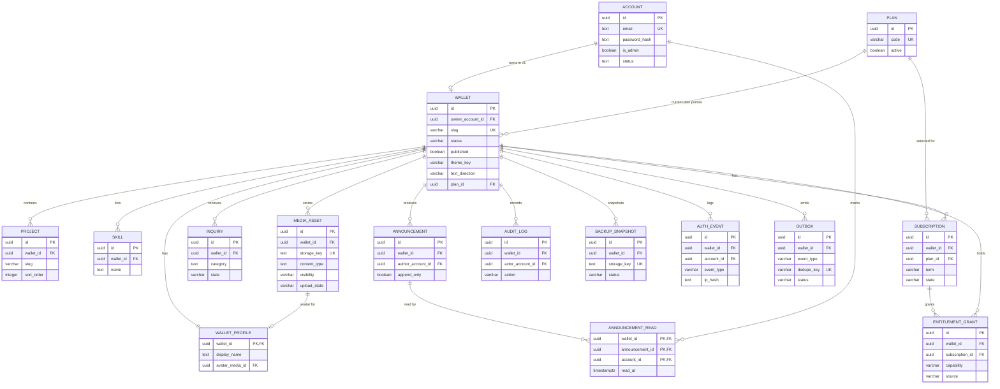
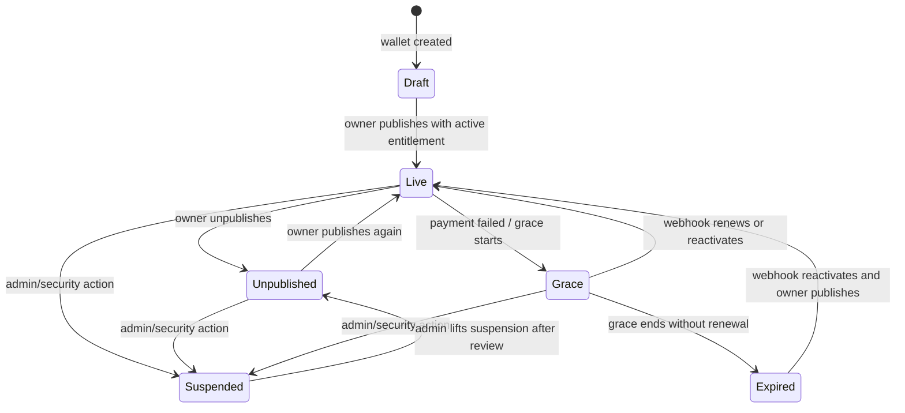

# Codexx Wallet — Domain and Data Model

This document defines the proposed target domain and data model for the chosen architecture. It is a decision document only; no implementation, migration, or configuration change is performed.

## 1. Decision statement (DECISION)

Adopt a **single relational database** as the only operational source of truth.

- PostgreSQL is production; SQLite is local development.
- Alembic migrations and database constraints replace implicit `db.create_all()`.
- `data.json` is a one-time import source and is retired after import.
- Every wallet-owned row carries `wallet_id` as a UUID, FK, `NOT NULL`, and indexed.
- The authorization service resolves `wallet_id` from the session and enforces ownership on every sensitive operation. No client-supplied wallet ID is trusted.
- Public routes read only published wallets. There is no per-field ACL in v1.
- All writes within a wallet are transactional. There are no dual writes.
- Notification and announcement delivery side effects use an outbox pattern with a single worker.
- Private media lives outside the webroot and is served through an authorized route; public media uses a public prefix; the DB holds metadata only.
- Entitlements are separate from core workspace behavior through `Plan`, `Subscription`, and `EntitlementGrant`.
- Billing has no financial wallet logic.

## 2. EVIDENCE — current data shape

| Observed fact | Source |
|---|---|
| `models.py` has 7 models in 91 lines: `Workspace`, `User`, `Project`, `Skill`, `Client`, `Message`, `VisitorLog`. | `[AUDIT/04 §2]`, `models.py:1-91` |
| No relationships, foreign keys, cascades, or indexes exist. | `[AUDIT/04 §2]`, `models.py:1-91` |
| `Message.workspace_id` is nullable; sender, receiver, and parent fields are unconstrained strings. | `[AUDIT/04 §2]`, `models.py:1-91` |
| `data.json` is authoritative for most concepts while SQL is authoritative for messages; no transaction spans them. | `[AUDIT/05 §1]`, `data.json` |
| There are 3 users with integer IDs, `role=user`, and no `is_verified`. | `[AUDIT/06 §4]`, `data.json` |
| There are 5 portfolios, 2 orphaned; global projects are 0. | `[AUDIT/05 §2]`, `data.json` |
| Notification credentials are stored in plaintext. | `[AUDIT/01 §5.3]`, `[AUDIT/04 §5.2]`, `data.json` |
| Archiving messages flashes success but deletes nothing. | `[DISCOVERY/05 §4.4]` |
| Four conflicting unread definitions and an unauthenticated poll exist. | `[AUDIT/08 §2]`, `[DISCOVERY/05 §4.2]` |
| Raw IP visit logging is present. | `[AUDIT/07 §6]`, `models.py` |

## 3. Target entity inventory (DECISION)

| Entity | Purpose | Ownership | Lifecycle summary |
|---|---|---|---|
| `Account` | Owner identity and authentication | Identity-level; not wallet-owned | Created through a corrected account flow; disabled/retained, never inferred from project count |
| `Wallet` | Tenant aggregate: slug, status, publication, design set, plan pointer | Aggregate root; `Wallet.id` is `wallet_id` | Draft → active → grace → expired or suspended; publication is a separate flag |
| `WalletProfile` | Public identity content | Wallet-owned | Created with wallet; owner-editable; visible only when wallet is published |
| `Project` | Portfolio project content | Wallet-owned | Owner CRUD; effective delete; public only through published wallet |
| `Skill` | Skill taxonomy attached to the wallet | Wallet-owned | Owner CRUD; ordered list |
| `MediaAsset` | File metadata and storage keys | Wallet-owned | Upload pending → ready or failed; private/public classification; effective delete |
| `Inquiry` | Visitor-to-owner inquiry | Wallet-owned | Submitted → reviewed; no replies/threads |
| `Announcement` | One-way Administration-to-owner message | Wallet-owned as recipient | Append-only; no edit/delete; corrective announcement instead |
| `AnnouncementRead` | Per-recipient read receipt | Wallet-owned | Idempotent read; no reply state |
| `Plan` | Product catalog with typed capability limits | Global catalog; not wallet-owned | Admin-managed; active/inactive; no prices in reconstruction docs |
| `Subscription` | Wallet subscription state and term | Wallet-owned | Active, grace, expired, canceled |
| `EntitlementGrant` | Effective capabilities for a wallet | Wallet-owned | Granted, renewed, revoked, or expired through policy |
| `AuditLog` | Append-only sensitive action record | Wallet-scoped | Immutable; admin actions require target `wallet_id` |
| `BackupSnapshot` | Encrypted backup metadata and verification state | Wallet-owned | Requested → pending → complete → verified; retention applies |
| `AuthEvent` | Wallet-scoped authentication events with privacy-preserving identifiers | Wallet-owned | Append-only; hashed IP only, never raw IP |

Deferred and explicitly absent in v1: `Business/Organization`, multi-wallet per account, `Service`, public catalog/directory, CRM entities, member messaging entities, and financial wallet entities.

## 4. Mermaid ER diagram (DECISION)

`OUTBOX` is an infrastructure table owned by the notifications module, not a new domain aggregate. It is included because delivery semantics are part of the target data contract.

## 5. Target fields, types, constraints, and indexes (DECISION)

Nullability is stated as No or Yes. Every wallet-owned row has a `wallet_id` row below to make ownership explicit.

### 5.1 Identity and tenant root

| Entity | Field | Type | Null? | FK / rule | Index | Lifecycle note |
|---|---|---|---|---|---|---|
| `Account` | `id` | UUID | No | PK | PK | Stable identity; UUID replaces integer IDs |
| `Account` | `email` | TEXT | No | Unique, case-insensitive | Unique | No account enumeration in responses |
| `Account` | `password_hash` | TEXT | No | Werkzeug-compatible hash | None | Rehash on successful login; no plaintext |
| `Account` | `is_admin` | BOOLEAN | No | Default false | None | Admin role is explicit and audited |
| `Account` | `status` | Enum: active / disabled | No | Check constraint | Index | Disabled accounts retain data |
| `Account` | `created_at` | TIMESTAMPTZ | No | Server-set | None | Immutable |
| `Account` | `updated_at` | TIMESTAMPTZ | No | Service-set | None | Changes audited where sensitive |
| `Account` | `last_login_at` | TIMESTAMPTZ | Yes | AuthEvent also records detail | None | Display only |
| `Account` | `wallet_id` | — | — | Not wallet-owned; linked by `Wallet.owner_account_id` | — | One wallet per account in v1 |
| `Wallet` | `id` | UUID | No | PK; this is `wallet_id` | PK | Aggregate root |
| `Wallet` | `owner_account_id` | UUID | No | FK `Account.id`, unique | Unique | One wallet per account in v1 |
| `Wallet` | `slug` | VARCHAR(63) | No | Unique; preserves public URL shape | Unique | Change audited; old slug redirect optional |
| `Wallet` | `status` | Enum: draft / active / grace / expired / suspended | No | Check constraint | Index | Commercial state |
| `Wallet` | `published` | BOOLEAN | No | Default false | Index | Wallet-level visibility only |
| `Wallet` | `theme_key` | VARCHAR(32) | No | Allowlisted six themes | None | Preserves six theme CSS files |
| `Wallet` | `accent_color` | VARCHAR(16) | Yes | Validated token | None | No arbitrary CSS injection |
| `Wallet` | `layout_variant` | VARCHAR(32) | No | Default classic; allowlist | None | Design-set field |
| `Wallet` | `locale` | VARCHAR(16) | No | Default en | None | Supports Arabic/RTL v1 requirement |
| `Wallet` | `text_direction` | Enum: ltr / rtl | No | Default ltr | None | Themes are reused with direction support |
| `Wallet` | `plan_id` | UUID | Yes | FK `Plan.id`; updated only by billing webhook | Index | Pointer only; authoritative entitlement is `EntitlementGrant` |
| `Wallet` | `published_at` | TIMESTAMPTZ | Yes | Set by publication service | None | Null when never/currently unpublished |
| `Wallet` | `created_at` | TIMESTAMPTZ | No | Server-set | None | Immutable |
| `Wallet` | `updated_at` | TIMESTAMPTZ | No | Service-set | None | Sensitive updates audited |

### 5.2 Public content and media

| Entity | Field | Type | Null? | FK / rule | Index | Lifecycle note |
|---|---|---|---|---|---|---|
| `WalletProfile` | `wallet_id` | UUID | No | PK and FK `Wallet.id` | PK | Wallet-owned row; cascade from wallet |
| `WalletProfile` | `display_name` | TEXT | No | Length and escape rules | None | Public when wallet published |
| `WalletProfile` | `headline` | TEXT | Yes | Length rule | None | Owner-editable |
| `WalletProfile` | `bio` | TEXT | Yes | Length rule | None | Escaped in templates |
| `WalletProfile` | `location` | TEXT | Yes | Length rule | None | Optional |
| `WalletProfile` | `website_url` | TEXT | Yes | URL validation | None | Optional |
| `WalletProfile` | `avatar_media_id` | UUID | Yes | FK `MediaAsset.id`; same-wallet check | Index | Restrict delete while referenced |
| `WalletProfile` | `created_at` | TIMESTAMPTZ | No | Server-set | None | Immutable |
| `WalletProfile` | `updated_at` | TIMESTAMPTZ | No | Service-set | None | Owner edits |
| `Project` | `id` | UUID | No | PK | PK | Stable project identity |
| `Project` | `wallet_id` | UUID | No | FK `Wallet.id` | Index | Wallet-owned row |
| `Project` | `slug` | VARCHAR(120) | No | Unique with `wallet_id` | Unique `(wallet_id, slug)` | Preserves public project URL shape |
| `Project` | `title` | TEXT | No | Length rule | None | Required |
| `Project` | `summary` | TEXT | Yes | Length rule | None | Public presentation |
| `Project` | `body` | TEXT | Yes | Length rule | None | Escaped rich text or plain text only |
| `Project` | `sort_order` | INTEGER | No | Default 0 | Index `(wallet_id, sort_order)` | Owner ordering |
| `Project` | `deleted_at` | TIMESTAMPTZ | Yes | Effective delete marker | Index | Excluded from public and normal lists |
| `Project` | `created_at` | TIMESTAMPTZ | No | Server-set | None | Immutable |
| `Project` | `updated_at` | TIMESTAMPTZ | No | Service-set | None | Owner edits |
| `Skill` | `id` | UUID | No | PK | PK | Stable identity |
| `Skill` | `wallet_id` | UUID | No | FK `Wallet.id` | Index | Wallet-owned row |
| `Skill` | `name` | TEXT | No | Unique with `wallet_id` | Unique `(wallet_id, name)` | Owner-editable |
| `Skill` | `category` | TEXT | Yes | Controlled vocabulary | Index `(wallet_id, category)` | No global catalog |
| `Skill` | `sort_order` | INTEGER | No | Default 0 | Index | Owner ordering |
| `MediaAsset` | `id` | UUID | No | PK | PK | Stable identity |
| `MediaAsset` | `wallet_id` | UUID | No | FK `Wallet.id` | Index | Wallet-owned row |
| `MediaAsset` | `storage_key` | TEXT | No | Unique randomized key | Unique | Randomized name, not user filename |
| `MediaAsset` | `original_filename` | TEXT | No | Display only; escaped | None | Never used as path |
| `MediaAsset` | `content_type` | TEXT | No | Allowlist | None | No extension-only trust |
| `MediaAsset` | `size_bytes` | BIGINT | No | Max-size constraint | None | Validated at upload |
| `MediaAsset` | `visibility` | Enum: public / private | No | Check constraint | Index `(wallet_id, visibility)` | Public prefix only when wallet published |
| `MediaAsset` | `width` | INTEGER | Yes | Image metadata | None | Optional |
| `MediaAsset` | `height` | INTEGER | Yes | Image metadata | None | Optional |
| `MediaAsset` | `checksum` | TEXT | Yes | Integrity check | None | Optional |
| `MediaAsset` | `upload_state` | Enum: pending / ready / failed | No | Check constraint | Index | Worker-finalized |
| `MediaAsset` | `created_by_account_id` | UUID | No | FK `Account.id` | Index | Auditable uploader |
| `MediaAsset` | `created_at` | TIMESTAMPTZ | No | Server-set | None | Immutable |
| `MediaAsset` | `deleted_at` | TIMESTAMPTZ | Yes | Effective delete marker | Index | Physical purge via outbox after commit |

### 5.3 Interaction and announcements

| Entity | Field | Type | Null? | FK / rule | Index | Lifecycle note |
|---|---|---|---|---|---|---|
| `Inquiry` | `id` | UUID | No | PK | PK | Stable identity |
| `Inquiry` | `wallet_id` | UUID | No | FK `Wallet.id` | Index | Wallet-owned row |
| `Inquiry` | `category` | TEXT | No | Preserved inquiry taxonomy allowlist | Index `(wallet_id, category)` | No member-to-member category |
| `Inquiry` | `name` | TEXT | No | Length rule | None | Visitor-supplied, escaped |
| `Inquiry` | `email` | TEXT | No | Format validation | None | Visitor contact |
| `Inquiry` | `subject` | TEXT | Yes | Length rule | None | Optional |
| `Inquiry` | `body` | TEXT | No | Length rule | None | Escaped; no reply/thread |
| `Inquiry` | `state` | Enum: new / reviewed | No | Check constraint | Index `(wallet_id, state)` | One-way lifecycle |
| `Inquiry` | `created_at` | TIMESTAMPTZ | No | Server-set | Index `(wallet_id, created_at)` | Import may mark provenance |
| `Inquiry` | `reviewed_at` | TIMESTAMPTZ | Yes | Set with state change | None | Null while new |
| `Inquiry` | `reviewed_by_account_id` | UUID | Yes | FK `Account.id` | Index | Audited reviewer |
| `Announcement` | `id` | UUID | No | PK | PK | Append-only record |
| `Announcement` | `wallet_id` | UUID | No | FK `Wallet.id`; recipient wallet | Index | Wallet-owned row |
| `Announcement` | `author_account_id` | UUID | No | FK `Account.id`; admin actor | Index | Author identity retained |
| `Announcement` | `title` | TEXT | No | Length rule | None | Owner-facing |
| `Announcement` | `body` | TEXT | No | Length rule; escaped | None | No replies or threads |
| `Announcement` | `audience` | Enum: wallet_owner | No | Check constraint | None | v1 has one audience only |
| `Announcement` | `created_at` | TIMESTAMPTZ | No | Server-set | Index `(wallet_id, created_at)` | Immutable |
| `Announcement` | `expires_at` | TIMESTAMPTZ | Yes | Display window only | None | Expiry hides display; record remains |
| `AnnouncementRead` | `wallet_id` | UUID | No | PK part and FK `Wallet.id` | PK part, index | Wallet-owned row |
| `AnnouncementRead` | `announcement_id` | UUID | No | PK part and FK `Announcement.id` | PK part | Cascades from announcement |
| `AnnouncementRead` | `account_id` | UUID | No | PK part and FK `Account.id` | PK part | Recipient owner |
| `AnnouncementRead` | `read_at` | TIMESTAMPTZ | No | Server-set | Index | Idempotent receipt; no reply state |

`AnnouncementRead` uses a composite key on `wallet_id`, `announcement_id`, and `account_id`; no separate mutable unread counter exists.

### 5.4 Commercial and operational records

| Entity | Field | Type | Null? | FK / rule | Index | Lifecycle note |
|---|---|---|---|---|---|---|
| `Plan` | `id` | UUID | No | PK | PK | Global catalog row |
| `Plan` | `code` | VARCHAR(64) | No | Unique; Starter/Base, Professional, Business | Unique | Stable billing code |
| `Plan` | `name` | TEXT | No | Length rule | None | Display name |
| `Plan` | `max_projects` | INTEGER | Yes | Null means unlimited | None | Typed capability |
| `Plan` | `max_media_bytes` | BIGINT | Yes | Null means unlimited | None | Typed capability |
| `Plan` | `allow_export` | BOOLEAN | No | Default true in grace/expired policy | None | Retained-data export |
| `Plan` | `allow_advanced_design` | BOOLEAN | No | Capability flag | None | Entitlement policy reads |
| `Plan` | `allow_publication` | BOOLEAN | No | Capability flag | None | Publication policy reads |
| `Plan` | `provider_plan_ref` | TEXT | No | Billing provider reference | Unique | No prices stored here |
| `Plan` | `active` | BOOLEAN | No | Default true | Index | Inactive plans cannot be newly selected |
| `Plan` | `created_at` | TIMESTAMPTZ | No | Server-set | None | Immutable |
| `Plan` | `updated_at` | TIMESTAMPTZ | No | Service-set | None | Catalog changes audited |
| `Plan` | `wallet_id` | — | — | Not wallet-owned | — | Global catalog |
| `Subscription` | `id` | UUID | No | PK | PK | Stable identity |
| `Subscription` | `wallet_id` | UUID | No | FK `Wallet.id` | Index | Wallet-owned row |
| `Subscription` | `plan_id` | UUID | No | FK `Plan.id` | Index | Authoritative plan selection |
| `Subscription` | `provider_subscription_ref` | TEXT | Yes | Unique with `wallet_id` | Unique `(wallet_id, provider_subscription_ref)` | Provider linkage |
| `Subscription` | `term` | Enum: monthly / yearly / lifetime | No | Check constraint | Index | Lifetime has no period end |
| `Subscription` | `state` | Enum: active / grace / expired / canceled | No | Check constraint | Index `(wallet_id, state)` | Webhook-driven |
| `Subscription` | `current_period_start` | TIMESTAMPTZ | Yes | Provider event | None | Optional for manual grants |
| `Subscription` | `current_period_end` | TIMESTAMPTZ | Yes | Null for lifetime | None | Not client-supplied |
| `Subscription` | `grace_until` | TIMESTAMPTZ | Yes | Policy-set | Index | Expiration path |
| `Subscription` | `canceled_at` | TIMESTAMPTZ | Yes | Provider event | None | Audit visible |
| `Subscription` | `created_at` | TIMESTAMPTZ | No | Server-set | None | Immutable |
| `Subscription` | `updated_at` | TIMESTAMPTZ | No | Webhook service | None | Idempotent event application |
| `EntitlementGrant` | `id` | UUID | No | PK | PK | Stable identity |
| `EntitlementGrant` | `wallet_id` | UUID | No | FK `Wallet.id` | Index | Wallet-owned row |
| `EntitlementGrant` | `subscription_id` | UUID | Yes | FK `Subscription.id` | Index | Null for audited manual grant |
| `EntitlementGrant` | `capability` | VARCHAR(80) | No | Allowlisted capability name | Index `(wallet_id, capability)` | Example: export, publish, advanced design |
| `EntitlementGrant` | `source` | Enum: plan / grace / manual_grant | No | Check constraint | Index | Policy provenance |
| `EntitlementGrant` | `granted_at` | TIMESTAMPTZ | No | Server-set | None | Immutable grant time |
| `EntitlementGrant` | `expires_at` | TIMESTAMPTZ | Yes | Policy-set | Index | Null for lifetime/indefinite |
| `EntitlementGrant` | `revoked_at` | TIMESTAMPTZ | Yes | Policy or admin action | None | No destructive data effect |
| `AuditLog` | `id` | UUID | No | PK | PK | Append-only |
| `AuditLog` | `wallet_id` | UUID | No | FK `Wallet.id` | Index `(wallet_id, created_at)` | Every audited action targets a wallet |
| `AuditLog` | `actor_account_id` | UUID | Yes | FK `Account.id`; null for system/webhook/worker | Index | System actions still scoped to wallet |
| `AuditLog` | `action` | VARCHAR(120) | No | Controlled action names | Index | No free-form critical action |
| `AuditLog` | `target_type` | VARCHAR(80) | No | Controlled type names | None | Example: Project, Announcement, Subscription |
| `AuditLog` | `target_id` | UUID | Yes | No cross-wallet target accepted | Index | Null for wallet-level actions |
| `AuditLog` | `detail` | TEXT | Yes | Sanitized string only | None | No secrets or raw IP |
| `AuditLog` | `correlation_id` | TEXT | Yes | Unique with webhook action | Unique `(action, correlation_id)` for webhook actions | Idempotency and tracing |
| `AuditLog` | `created_at` | TIMESTAMPTZ | No | Server-set | Index | Immutable |
| `BackupSnapshot` | `id` | UUID | No | PK | PK | Stable identity |
| `BackupSnapshot` | `wallet_id` | UUID | No | FK `Wallet.id` | Index | Wallet-owned row |
| `BackupSnapshot` | `storage_key` | TEXT | No | Unique encrypted object key | Unique | Off-instance encrypted storage |
| `BackupSnapshot` | `status` | Enum: pending / complete / failed / verified | No | Check constraint | Index `(wallet_id, status)` | Worker-driven |
| `BackupSnapshot` | `size_bytes` | BIGINT | Yes | Worker-set | None | Optional |
| `BackupSnapshot` | `checksum` | TEXT | Yes | Worker-set | None | Integrity check |
| `BackupSnapshot` | `requested_by_account_id` | UUID | Yes | FK `Account.id` | Index | Auditable request |
| `BackupSnapshot` | `created_at` | TIMESTAMPTZ | No | Server-set | None | Immutable |
| `BackupSnapshot` | `verified_at` | TIMESTAMPTZ | Yes | Restore test | None | Null until restore verified |
| `BackupSnapshot` | `retention_until` | TIMESTAMPTZ | Yes | Policy-set | Index | Enforced by worker |
| `AuthEvent` | `id` | UUID | No | PK | PK | Append-only |
| `AuthEvent` | `wallet_id` | UUID | No | FK `Wallet.id` | Index | Wallet-owned row |
| `AuthEvent` | `account_id` | UUID | Yes | FK `Account.id` | Index | Null when account not resolved |
| `AuthEvent` | `event_type` | Enum: login_success / login_failure / logout / password_change | No | Check constraint | Index `(wallet_id, event_type, created_at)` | No raw credential data |
| `AuthEvent` | `ip_hash` | TEXT | Yes | Salted privacy-preserving hash | None | Replaces raw IP analytics |
| `AuthEvent` | `user_agent_hash` | TEXT | Yes | Privacy-preserving hash | None | Optional |
| `AuthEvent` | `created_at` | TIMESTAMPTZ | No | Server-set | Index | Immutable |

### 5.5 Infrastructure outbox

| Entity | Field | Type | Null? | FK / rule | Index | Lifecycle note |
|---|---|---|---|---|---|---|
| `Outbox` | `id` | UUID | No | PK | PK | Infrastructure table, worker-owned |
| `Outbox` | `wallet_id` | UUID | No | FK `Wallet.id` | Index | Tenant-scoped delivery |
| `Outbox` | `event_type` | VARCHAR(120) | No | Controlled event names | Index | Announcement, inquiry, backup events |
| `Outbox` | `target_type` | VARCHAR(80) | No | Controlled type names | None | IDs only, no secrets |
| `Outbox` | `target_id` | UUID | No | Referenced domain row | Index | Resolved after commit |
| `Outbox` | `dedupe_key` | TEXT | No | Unique | Unique | Prevents duplicate senders |
| `Outbox` | `attempts` | INTEGER | No | Default 0 | None | Bounded retry |
| `Outbox` | `next_attempt_at` | TIMESTAMPTZ | No | Backoff-driven | Index `(status, next_attempt_at)` | Worker claim order |
| `Outbox` | `status` | Enum: pending / delivered / failed | No | Check constraint | Index | Final state retained for audit |
| `Outbox` | `delivered_at` | TIMESTAMPTZ | Yes | Worker-set | None | Null until delivered |
| `Outbox` | `created_at` | TIMESTAMPTZ | No | Server-set | None | Immutable |

## 6. Tenant isolation mechanics (DECISION)

| Rule | Mechanism | Enforcement point | Failure behavior |
|---|---|---|---|
| Every wallet-owned row has `wallet_id` | UUID FK, `NOT NULL`, indexed | DB constraints and Alembic migration | Insert/update rejected |
| `wallet_id` is session-derived | Auth resolves `Account` → `Wallet`; repository requires explicit `wallet_id` | Service and repository layers | 403/404 generic; client-supplied ID ignored or rejected |
| No unscoped owned-row query | Repository templates require tenant predicate | Code review and tests | Unscoped query fails review/test |
| Cross-wallet references fail | Same-wallet checks for avatar, media, announcement receipts | Service before commit | 403 generic; no data exposure |
| Public reads only published wallets | `published = true` predicate on every public query | Public route/service | 404 for unknown/unpublished wallet |
| No per-field ACL in v1 | Wallet-level published/unpublished only | Publication policy | Project/skill fields are not individually permissioned |
| Admin actions are wallet-scoped | `AuditLog.wallet_id` required on admin actions | Admin service and audit policy | Action rejected if target wallet cannot be resolved |
| Worker events are tenant-scoped | Outbox `wallet_id` drives recipient resolution | Worker | No cross-wallet notification fan-out |
| Isolation is tested | Two-wallet negative test suite | CI | Any cross-wallet read/write blocks release |

## 7. Transaction boundaries (DECISION)

| Operation | Transaction scope | Outbox | Notes |
|---|---|---|---|
| Account creation and wallet creation | One DB transaction creating `Account` and `Wallet` | Optional welcome event | Corrected flow only; no legacy `/register` |
| Profile, project, skill update | All row writes plus audit in one transaction | Yes, if notification side effect required | No `data.json` write |
| Media upload finalize | Metadata insert/update, audit, outbox in one transaction after file validation | Yes | Physical file write precedes commit; failed commit triggers cleanup |
| Media delete | Set `deleted_at`, audit, enqueue physical purge | Yes | Public route stops serving immediately after commit |
| Inquiry submission | `Inquiry` insert plus safe audit and outbox in one transaction | Yes | Rate limiting occurs before transaction |
| Announcement creation | `Announcement` insert plus audit and outbox in one transaction | Yes | Append-only; corrective record for corrections |
| Announcement read receipt | Upsert `AnnouncementRead` plus audit if required | No sender side effect | Idempotent; no reply/thread |
| Billing webhook | `Subscription`, grants, wallet pointer, audit in one transaction | Yes, if entitlement notification required | Idempotency via `correlation_id` |
| Backup request | `BackupSnapshot` pending row plus audit and outbox in one transaction | Yes | Worker transitions status in later transactions |
| One-time import | One transaction per wallet/tenant unit | Not used | Quarantine staging outside runtime domain |

There are no dual writes. Any operation that spans DB and an external effect uses the outbox so the DB commit is authoritative.

## 8. Outbox and notification model (DECISION)

| Concern | Rule |
|---|---|
| Single sender | One worker drains `Outbox`; no duplicate notification senders |
| Payload | IDs and safe references only; no secrets, credentials, or raw IP |
| Idempotency | `dedupe_key` unique; duplicate provider events do not create duplicate delivery |
| Retry | Bounded attempts with backoff; terminal failure recorded and audited |
| Ordering | Per-wallet ordering for announcement-related events |
| Delivery proof | `status`, `attempts`, `delivered_at`; provider response metadata recorded safely |
| Secrets | Provider credentials live in env/vault with rotation; never in DB or `data.json` |
| Announcement receipts | `AnnouncementRead` is a domain record; outbox only handles delivery side effects |

## 9. Media storage model (DECISION)

| Concern | Rule |
|---|---|
| Private media | Stored outside webroot; served only through authorized route with session wallet ownership |
| Public media | Stored under public prefix; served only when owning wallet is published and asset visibility is public |
| Metadata | DB is source of truth for owner, content type, size, visibility, state, and checksum |
| Naming | Randomized `storage_key`; original filename is display-only and escaped |
| Validation | Content-type allowlist and size limit enforced server-side; extension alone is not trusted |
| Delete | DB `deleted_at` is effective immediately; worker purges physical object after commit |
| Same-wallet checks | Avatar and receiving wallet must match `MediaAsset.wallet_id` |
| No raw path exposure | Clients receive controlled URLs or IDs, never filesystem paths |

## 10. Publication and visibility state machine (DECISION)

| State | `published` | Write access | Data retention | Notes |
|---|---|---|---|---|
| Draft | false | Owner may edit | Full | Not publicly discoverable |
| Live | true | Owner may edit with entitlement | Full | Public wallet presentation active |
| Unpublished | false | Owner may edit | Full | Owner chooses privacy |
| Grace | false | Read-only except export and remediation | Full | Auto-unpublished; export remains available |
| Expired | false | Read-only except export | Full | Data retained; publication blocked |
| Suspended | false | No normal owner writes | Full | Admin/security state; audited |

Public routes read only `published = true` wallets. Projects, skills, and public media inherit wallet-level visibility; there is no per-field ACL in v1.

## 11. Subscription and entitlement lifecycle (DECISION)

| State | Trigger | Entitlements | Write access | Publication | Data retention and export |
|---|---|---|---|---|---|
| Active | `checkout.completed`, renewal, successful upgrade | Plan capabilities granted | Allowed per capability | Allowed if entitlement permits | Full |
| Grace | `payment.failed` or equivalent provider event | Reduced capability set; export retained | Read-only except export/remediation | Auto-unpublished | Full |
| Expired | Grace end without renewal | Publication and write capabilities revoked | Read-only except export | Unpublished | Full; export required |
| Canceled | Provider cancellation event | Same as expired after grace | Read-only except export | Unpublished | Full; export required |

Additional rules:

| Flow | Rule |
|---|---|
| Upgrade | Applies on verified provider event in one transaction; new grants replace prior plan grants |
| Downgrade | Revokes capabilities above the new plan; never deletes wallet data |
| Lifetime term | `current_period_end` is null; still subject to suspension and entitlement policy |
| Manual grant | Requires admin action, target `wallet_id`, expiry, and audit record |
| Expiration | Never deletes profile, projects, skills, inquiries, media metadata, or announcements |
| Export | Available in grace and expired states under policy; export access is audited |
| Prices | Not part of this reconstruction documentation; billing provider and catalog own commercial presentation |

## 12. Audit and backup model (DECISION)

| Concern | Rule |
|---|---|
| Audit scope | Every sensitive owner and admin operation writes `AuditLog` with `wallet_id` |
| Immutability | Audit rows are append-only; no update/delete path |
| Actor | `actor_account_id` may be null for system, webhook, or worker actions, but `wallet_id` remains required |
| Admin actions | Publication overrides, announcements, manual grants, backup access, and restore verification are always audited |
| Privacy | No raw IP, no plaintext credentials, no secrets in `detail` |
| Backup access | Not downloadable by any logged-in user; access requires owner/admin policy and audit |
| Encryption | Snapshots are encrypted off-instance; keys live in env/vault, not in the database |
| Restore | `verified_at` is set only after a tested restore; unverified backups are not treated as release artifacts |
| Retention | `retention_until` enforced by the worker; deletion of expired snapshots is audited |
| Backup content | DB tenant data and media object references; no plaintext notification credentials |

## 13. Migration mapping from current sources (DECISION)

`data.json` and SQL are import sources only. The importer is one-time, auditable, and run before the runtime app uses the new schema.

| Current source | Current shape | Target | Mapping rule |
|---|---|---|---|
| `users` in `data.json` | 3 users, integer IDs, `role=user`, no `is_verified` | `Account` + `Wallet` | Generate UUIDs; preserve email and Werkzeug-compatible hash; set explicit role; create one wallet per user; do not infer verification from project count |
| `portfolios` in `data.json` | 5 portfolios, 2 orphaned | `WalletProfile` + `Project` + `Skill` + `MediaAsset` | Map matched portfolios to owner wallet; orphaned portfolios go to quarantine; never guess an owner |
| Portfolio profile fields | Public identity content | `WalletProfile` | Preserve display vocabulary; set `text_direction`/`locale` explicitly during import review |
| Nested projects / current project records | No global projects; `global projects=0` | `Project` | Attach to the imported wallet only; preserve title, slug, summary/body, and reasonable ordering; no public catalog row |
| Portfolio skills | Skill strings | `Skill` | Attach to wallet; preserve labels where safe; deduplicate per wallet |
| Portfolio media references | File paths and extension-based assumptions | `MediaAsset` | Create metadata with new randomized storage keys; validate content type and size; classify public/private; missing binaries go to quarantine |
| SQL `workspace` | Current aggregate model with weak constraints | `Wallet` | Map to tenant root; replace any nullable/informal ownership with `owner_account_id` and UUID key |
| SQL `messages` | SQL-authoritative, nullable workspace ID, string participants, threads/replies | `Inquiry` | Import only meaningful inquiries with a resolvable wallet and contact content; flatten replies into body context only if meaningful; drop thread/read-state/unread machinery |
| SQL `client` | Weak client records | `Inquiry` contact fields or quarantine | Map only when linked to a meaningful message; otherwise quarantine for review; no CRM entity |
| Notification credentials | Plaintext secrets | None | **DO NOT IMPORT**; re-enter through vault with rotation |
| `ip_log` / `VisitorLog` | Raw IP analytics | None | **DO NOT IMPORT**; privacy requirement forbids carry-forward |
| Demo mode flags | Demo writes allowed | None | **DO NOT IMPORT** |
| Dead subscription mockup / `subscription.html` | Broken mockup with missing `payment` endpoint | `Plan` catalog created from product decisions only | Do not import mockup behavior; no prices in reconstruction docs |
| “Archive” flags from messaging | Flash success with no delete | None | **DO NOT IMPORT**; false archive state is removed |
| Verification-by-three-projects | Implicit heuristic | None | **DO NOT IMPORT**; verification is explicit and out of band |
| Public catalog/directory data | No v1 concept | None | **DO NOT IMPORT** into a public directory |

### 13.1 Quarantine rules (DECISION)

| Case | Rule | Resolution |
|---|---|---|
| Portfolio with no matching user | Quarantine with original source key; never publish | Admin links to an account, exports, or discards with recorded decision |
| Message with missing or unvalidated receiver | Quarantine unless content is meaningful and wallet resolves | Manual review; no guessed recipient |
| Project referencing unknown portfolio | Quarantine | Link after wallet review or discard |
| Media metadata with missing binary | Quarantine metadata; no public exposure | Supply binary, validate, then import |
| Duplicate wallet slug | Generate a reviewed suffix and log collision | Owner/admin confirms final slug |
| Conflicting unread definitions | Do not import unread counters | New `AnnouncementRead` model starts clean |
| Blank or invalid legacy date | Import with provenance marker and import timestamp | No fabricated public “received at” claim |
| Plaintext credential field | Never stage in the operational DB | Destroy after import verification; re-enter via vault |

## 14. Constraints replacing implicit `db.create_all()` (DECISION)

| Legacy behavior | Target constraint or mechanism |
|---|---|
| `db.create_all()` runs on import | Explicit Alembic migrations run as a deployment step; app import is side-effect free |
| No foreign keys | FKs for every owned row; `ON DELETE CASCADE` for wallet children where appropriate; restrict for referenced media |
| Nullable `Message.workspace_id` | `wallet_id` UUID FK `NOT NULL` on every owned row |
| Unconstrained strings for IDs and participants | UUID keys, typed enums/check constraints, length limits, controlled vocabularies |
| No indexes | Indexes on `wallet_id`, slugs, status fields, timestamps, and unique keys |
| Dual persistence | One relational DB; `data.json` retired after one-time import |
| Fake archive delete | Effective `deleted_at` or real delete; no success flash without state change |
| Raw IP analytics | Salted hashes only in `AuthEvent`; `ip_log` not imported |
| Plaintext notification credentials | Env/vault only; rotation; never in DB or imported data |
| Dead notification senders | Single outbox worker with dedupe, retry, and audit |
| No per-field ACL but unsafe public reads | Wallet-level `published` predicate on every public query |

Status: DECISION — awaiting product-owner approval. No implementation performed.
